# Timber Loot Tycoon — Alpha 2

Spielbarer Godot-4.6-Wiederaufbau mit eigener Low-Poly-Grafik, prozeduralen Texturen und erzeugten Soundeffekten. Die Holzindustrie wächst zu einer Stadt mit Immobilien und Großprojekten. Der frühere Quellstand ist nicht verfügbar; dieses Projekt setzt die Anforderungen aus dem Chat neu um. Entwicklungsfassung, keine nachgewiesen marktreife App.

## Ladehöfe und Rückstau — 0.29.4-alpha.2

Weitere Staus aus der veröffentlichten 0.29.3 nachgestellt: Hofzufahrten konnten
sich gegenseitig blockieren; abbiegende Fahrzeuge fuhren trotz voller Ausfahrt
in die Kreuzung. Ladehöfe disponieren nun eine laufende Frachttour und halten
weitere reservierte Ladungen im Depot. Einfahrt und leere Rückfahrt erhalten
getrennte Hofseiten. Baustellen und Ladenlinie wechseln sich pro Ladehof ab.

Beim Update werden noch nicht angelieferte alte Frachten einmal vom bisherigen
Depot neu disponiert. Ladungsmengen, Vorräte, bereits gutgeschriebene Lieferungen
und Baustellenfortschritt bleiben erhalten. Die vorige Kreuzungskorrektur allein
hatte diesen Fehler nicht beseitigt.

[Änderungen und Nachweise](docs/TRAFFIC-294.md) ·
[Installation](docs/alpha2-yard/START-HIER.txt) ·
[Testplan](docs/alpha2-yard/TESTPLAN.txt) · [Downloads](releases/README.md).

## Verkehrsfix — 0.29.3-alpha.2

Die Teststadt konnte sich an benachbarten Ampeln dauerhaft selbst blockieren:
Gegenverkehr auf seiner eigenen Spur galt fälschlich als Querverkehr. Grün gibt
jetzt beide Spuren einer Richtung frei; bereits festgefahrene Testlieferungen
kommen wieder an. Anrückende Löschfahrzeuge fordern Grün an und lassen belegte
Kreuzungen zunächst räumen. Waren, Geld und Fahrzeuge bleiben echte Bestände.

[Änderungen und Nachweis](docs/TRAFFIC-293.md) ·
[Installation](docs/alpha2-traffic/START-HIER.txt) ·
[Testplan](docs/alpha2-traffic/TESTPLAN.txt) · [Downloads](releases/README.md).

## Schneller laden & App-Wechsel — 0.29.2-alpha.2

Die Offline-Berechnung arbeitet jetzt auf einer getrennten Kopie der Firma und
unabhängig vom sichtbaren Spielfenster. Sie startet schon vor dem ersten Ladeframe.
Minimieren pausiert diesen Rechenlauf nicht mehr durch die Spielschleife; Android
kann den ganzen Prozess weiterhin anhalten oder beenden. Erst das fertige Ergebnis
wird übernommen und gespeichert. Schließen stoppt die Berechnung sicher.

Verkehr prüft nur nahe Kreuzungen und verwendet bereits berechnete Positionen und
Richtungen erneut. Im Desktop-Vergleich mit 20 Häusern, acht LKW und acht Stunden
Abwesenheit: **83,887 → 21,675 Sekunden**, etwa **3,87× schneller**, identischer
Firmenstand. Das ist keine zugesicherte Ladezeit oder Messung auf einem Handy.

[Änderungen und Nutzen](docs/PERFORMANCE-292.md) ·
[Installation](docs/alpha2-performance/START-HIER.txt) ·
[Testplan](docs/alpha2-performance/TESTPLAN.txt) · [Downloads](releases/README.md).

## Startfix — 0.29.1-alpha.2

Der Start wartet nicht länger unsichtbar auf die komplette Offline-Berechnung.
Logo, Ladefortschritt und eine sichere Abbruchmöglichkeit erscheinen zuerst;
die Firma wird anschließend abschnittsweise aktualisiert. Auch Androids
Hintergrundwechsel verwendet diesen Ablauf. Teilstände überschreiben den
bisherigen Spielstand nicht. Als Update über die vorhandene Alpha installieren.

[Änderungen und Nutzen](docs/STARTFIX-291.md) ·
[Installation](docs/alpha2-startfix/START-HIER.txt) ·
[Testplan](docs/alpha2-startfix/TESTPLAN.txt) · [Downloads](releases/README.md).

## Alpha 2 — 0.29-alpha.2

Rückmeldungen aus dem ersten Handytest: neue Flammen und weicher Rauch,
kompakte Einsatzanzeige, geräumte Bauflächen einschließlich BOSS-Baum,
versetzte Forstmaschinen und laufende Baustellenteams. Ampeln und Abstände
steuern den tatsächlichen Fahrfortschritt von LKWs, Diensten und Bussen.
Ein Techniker repariert ausgefallene Ampeln. Bauleiterin Mara verteilt Teams,
wechselt Bau- und Ladenlieferungen bei knapper Flotte ab und erklärt Engpässe.

[Änderungen und Spielernutzen](docs/ALPHA2.md),
[Installation](docs/alpha2/START-HIER.txt), [Testplan](docs/alpha2/TESTPLAN.txt).
Als Update über Alpha 1 installieren, **nicht deinstallieren**.

## Alpha 1 — 0.28-alpha.1

Ein neuer 3D-Startbildschirm und Benno begleiten den ersten spielbaren Einstieg:
fünf Bäume → Holz abliefern → echte Bretter → erster Verkauf → eigene Hütte.
Die Anleitung bleibt klein, lässt sich pausieren und setzt gespeicherten Fortschritt fort.
Erfahrene Spieler spielen direkt weiter.

Fehler bei Tutorialfortschritt, Szenenwechseln per Touch, Android-Zurück,
Texteingaben und beschädigten Speicherdateien sind abgesichert. Kleine Displays
und große Schrift haben eine kompaktere Navigation. **Mehr → Alpha 1 · Testen &
Feedback** bietet einen bearbeitbaren, kopierbaren Bericht ohne automatisches Senden.

[Alpha-Änderungen und Spielernutzen](docs/ALPHA1.md),
[Installation](docs/alpha1/START-HIER.txt), [Testplan](docs/alpha1/TESTPLAN.txt).
Die Alpha aktualisiert dieselbe App ab 0.23. **Nicht vorher deinstallieren.**
Die APK heißt im Launcher jetzt **Timber Loot Alpha**.

## Neu in 0.27 — freie Welt & Autobahnexport

Baue Häuser und Betriebe auf dem ganzen freien, ebenen Festland. Gesperrte Biome
müssen erst erschlossen werden; sichtbare Grenzen, Bauvorschau und Karte zeigen
den Schutzbereich. Feste Grundstücks- und Gebäudegrenzen entfallen.

**Mehr → Autobahn & Exporthandel**: Verbinde den Markt über selbst gebaute Straßen
mit dem Anschluss **300 / 176**. Ab **80 / 176** kostet die direkte Zufahrt bei
Prestige 0 **1.540 Spielmünzen**. Echte LKW verladen freie Ware und bezahlen erst
nach Ankunft, mit 15 % Fernhandelsbonus. Die Rückfahrt belegt den LKW weiterhin;
Baustoffe und andere Transporte teilen dieselbe Flotte. Lokaler Verkauf bleibt
verfügbar. Hafen und Flughafen sind vorbereitet und geplant, noch kein aktiver
Schiffs- oder Flugexport.

[Änderungen, Gründe, Spielernutzen und Qualitätswirkung](docs/WORLD-TRADE27.md).
Bestehende Spielstände, Paket und Testsignatur bleiben gültig: als Update installieren.

## Neu in 0.26 — zehn Details für eine lebendige Welt

Gemeinsamer Wind für Rauch und Bäume, räumliche Feuerwehrgeräusche, Holzknacken und
Aufschlag, sichtbare Baumstümpfe, nasse Oberflächen und Pfützen, Vögel und Hasen,
Be-/Entladeanimationen, Ausbau-Enthüllung, kurze Produktionshinweise und weichere
Kameranavigation. **Mehr → Fotomodus & Galerie** öffnet drei Kamerawinkel und eine
PNG-Galerie im Spiel. Die Aufnahme enthält weder HUD noch Weltbeschriftungen.

[Alle zehn Aufgaben mit Gründen, Spielernutzen und Qualitätswirkung](docs/DETAIL-PASS26.md).
Wirtschaft, Bau- und Transportzeiten bleiben gültig. Keine zusätzlichen Berechtigungen.
Fotos werden im App-Speicher auf diesem Gerät abgelegt; kein automatischer Export in
die Systemgalerie. Die Test-App lässt sich über die bisherigen Versionen ab 0.23 updaten.

## Neu in 0.25 — Waldleben und Qualitätsüberarbeitung

- Ruhigeres HUD mit hervorgehobenen Währungen, echtem Zielfortschritt und einem
  gemeinsamen Mitteilungseingang. Meldungen werden nacheinander lesbar angezeigt.
- Dezenter Baumwind, gerichtete Fallanimationen und Rauch aus Schornsteinen.
  Sägespäne, Baudunst und Trocknerdampf folgen dem tatsächlichen Arbeitszustand.
- Brände mit Funken, warmem Licht, Wasserdunst und Fortschrittsanzeigen. Erfolgreiches
  Löschen und reale Verkäufe bekommen eigene sichtbare Rückmeldungen.
- Erkennbare Ausbaugestaltung bis zur Premiumstufe: Blumen, Lageranbauten, größere
  Unterstände, Solardächer und Messingakzente. Bestehende höhere Stufen bleiben erhalten.
- Begrenzte Effektpools, Akkumodus und reduzierte Bewegung. Wirtschaft und Spielstände
  bleiben gültig; es wurden keine neuen Kernmechaniken eingeführt.

[Dokumentation aller sieben Aufgaben](docs/QUALITY-PASS.md),
[Prüfungen und Grenzen](docs/VALIDATION.md).
Paket und Testsignatur bleiben wie bei 0.23/0.24: **als Update installieren**.

## Neu in 0.24 — Rauchmelder, Hydranten und Einsatzübersicht

- Rauchmelder für 125 Spielmünzen: neue Brände werden sofort statt nach zwölf
  Sekunden erkannt. Du kannst einen bemerkten Brand auch selbst alarmieren.
- Hydranten für 350 Spielmünzen: sichtbare Wasserversorgung für angeschlossene
  bewohnte Gebäude im horizontalen Umkreis von 44 m. Die tatsächliche Löscharbeit
  dauert 24 statt 36 Sekunden. Preise steigen wie bisher mit der Unternehmensära.
- Sichtbare Schlauchleitungen folgen der gespeicherten Straßenverbindung. Während
  ihres Einsatzes bleiben Hydrantstandort und benutzte Straßen geschützt.
- Einsatzzentrale mit freier/belegter Feuerwehrkapazität, genauer Ankunfts-/Restzeit
  und getrennten Zuständen für Erkennung, fehlende Zufahrt und belegte Fahrzeuge.

Unter **Mehr → Einsatzzentrale → Rauchmelder & Hydranten** oder über die Hauskarte
Brandschutz kaufen. Käufe kosten ausschließlich Spielmünzen, ohne laufenden
Verbrauch. Schon disponierte Einsätze behalten ihre berechneten Zeiten.
Paket, Testsignatur und Speicherordner bleiben wie bei 0.23: **als Update installieren**.

## Neu in 0.23 — Logo, Startintro und eigene Android-App

Ein neues Biber-Motiv begrüßt dich im kurzen Startintro: Wald → Holzverarbeitung →
Stadt. Das Intro lässt sich überspringen; **Spielen** öffnet jederzeit die echte
Spielwelt. Bei reduzierter Bewegung erscheint sofort der statische Titelbildschirm.
Logo und Oberfläche skalieren gleichmäßig auf Handy und Tablet.

Die neue Test-App heißt **Timber Loot Neu**, Paket
`com.whiskymitschuss.timberloot.reborn`, Version `0.23-test` / Code 2300.
Sie nutzt ausdrücklich einen neuen Testschlüssel und einen eigenen Speicherbereich.
Sie lässt sich neben der bisherigen App installieren; sie ist kein Update für die
alte Paketkennung. Die Funktionen von 0.21/0.22 sind enthalten.

## Neu in 0.21 und 0.22

- **0.21 Brandschutz:** gespeicherte Gebäudebrände, automatische Feuerwehrdisposition,
  echte Straßenanfahrt, Löscharbeit nach Ankunft und Nachbarschaftshilfe ohne eigene
  Wache. Höchstens zwei Ereignisse gleichzeitig; keine endgültigen Gebäudeverluste.
- **0.22 Einsatzstadt:** sichtbare Flammen, aufsteigender Rauch, Feuerwehrleute und
  Wasserstrahlen am realen Einsatzort. Akkumodus und reduzierte Bewegung gelten auch
  für die Effekte. Die Animation verändert keine Wirtschaft oder Einsatzzeiten.
- Neues gemeinsames Oberflächendesign mit dunklem Waldgrün, hellen Karten,
  klaren Zuständen und gruppierter Navigation. Eine rote Einsatzschaltfläche führt
  direkt zur Feuerwehr. Handy- und Tabletansichten skalieren gleichmäßig;
  breite Ansichten begrenzen die Lesebreite auf 760 logische Pixel.

Details und Prüfungen: [Brandschutz & Einsatzstadt](docs/FIRE-SAFETY.md).
[Gerenderte Vorschau](docs/preview-fire22.png), aus einem isoliert aufgebauten
Testprofil. **0.23 beginnt auf ausdrücklichen Nutzerwunsch eine neue Android-Linie.**
Die alte signierte APK 0.20 bleibt unverändert erhalten.

## Auf dem Handy testen

Die signierte Android-Test-APK liegt nach dem Build unter **[releases/Timber-Loot-Tycoon-v0.28-alpha.1.apk](releases/Timber-Loot-Tycoon-v0.28-alpha.1.apk)**. Auf GitHub die Datei öffnen und **Download raw file** wählen. Android 7.0+, ARM64/ARMv7, OpenGL ES 3.0; rund 63 MB. Die APK verwendet ausschließlich die Android-Berechtigung für optionale Vibration. Details: [Android-Test](docs/ANDROID.md).

## Spielen und entwickeln

`project.godot` mit Godot **4.6.3** importieren und **F5** drücken. Im vorbereiteten Linux-Checkout:

```bash
bash scripts/godot.sh --editor
bash scripts/test.sh
bash scripts/test_visual.sh  # Grafiktests mit vorhandenem Display oder Xvfb
python3 scripts/build_android.py
python3 scripts/backup.py
```

Der Android-Helfer lädt offizielle, fest versionierte und per Prüfsumme verifizierte Exportvorlagen und SDK-Pakete. Java mit `keytool` und Godot müssen bereits vorhanden sein. Cache, Editor-Konfiguration und Testsignaturschlüssel liegen außerhalb des Quellprojekts unter `/workspace/.timber-runtime`. Alternative Laufzeitpfade können über die im Skript dokumentierten Umgebungsvariablen gesetzt werden. Keine Gradle-Abhängigkeiten oder Benutzer-Zugangsdaten erforderlich.

## Neu in 0.20 — Die Waldstadt wird plastischer

- Gerundete Baukörper, eingerahmte Fenster, Fensterbänke, Dachränder und Lüftung. Vorgärten, Eingänge und passende kleine Grundstücksdetails ergänzen alle vorhandenen Stadtstufen 1–10.
- Eigene Oberflächen für Holz, Putz, Dach, Pflaster und lackierte Maschinen. Fenster reagieren mit warmem Licht auf die tatsächliche Nacht. Offene Holzbetriebe erhalten ausgearbeitete Werkstatt-Rückseiten und Ladebereiche.
- Gehwege mit Bordsteinen, Querungen und geschwungenen Ecken. Grundstücke und Haltestellen werden beim Ausschmücken berücksichtigt. LKWs, Einsatzfahrzeuge und Busse nehmen sichtbare Kurven; gespeicherte Transportaufträge und der echte Straßengraph bleiben ihre Grundlage.
- Weichere Baumkronen und bepflanzte freie Bauflächen. Weiterhin 1.000 nutzbare Bäume und ein festes, instanziertes Dekorationsbudget; beim Bauen werden Pflanzen automatisch entfernt.
- Android-Code 2000, gleiches Paket, gleicher Testschlüssel und Speicherformat 1. **Als Update installieren, vorher nicht deinstallieren.** Umfang, weitere Schritte und Unterschiede zwischen Simulation und Gestaltung: [Waldstadt](docs/WALDSTADT.md).

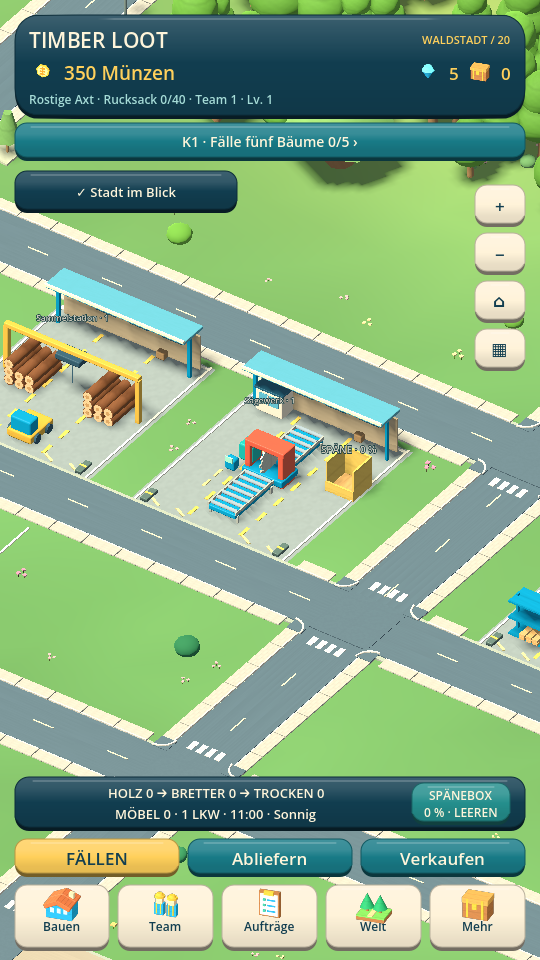

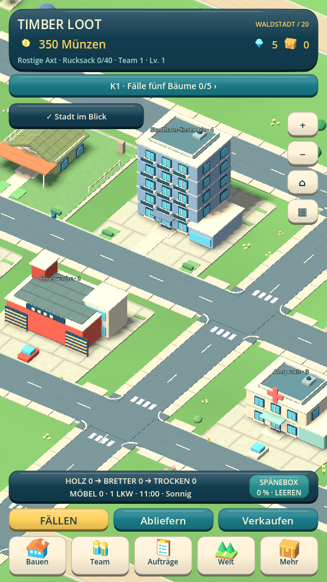

## Korrektur 0.19.2 — Gebäudekarte bleibt auf dem Bildschirm

- Gebäudekarten besitzen eine auf den verfügbaren Bildschirmbereich begrenzte Höhe. Wechselnde beziehungsweise vorübergehend große Textlayouts können die Karte nicht mehr über den oberen Bildschirmrand schieben.
- Titel und Schließen bleiben fest sichtbar. Längere Inhalte lassen sich mit dem Finger innerhalb der Karte scrollen; regelmäßige Aktualisierungen erhalten die Leseposition und ersetzen keine gedrückt gehaltenen Schaltflächen.
- Auf schmalen logischen Ansichten stehen die Aktionen untereinander. Die Navigation unten und der obere HUD-Bereich bleiben erreichbar. Materialanzeigen aus der Welt überdecken die Karte oder Baupalette nicht mehr.
- Android-Code 1920, gleiches Paket, gleicher Testschlüssel und bisheriger Speicherpfad. Als Update installieren, vorher nicht deinstallieren. Details zum gezielten Layout-/Touch-Test stehen in [Prüfbericht](docs/VALIDATION.md).

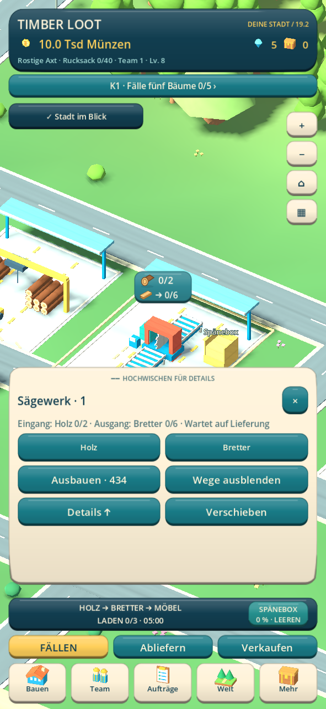

## Neu in 0.19.1 — Zehn Kapitel, ein wachsendes Rathaus

- **Zehn spielbare Kapitel mit 30 Aufgaben und zehn echten Rathaus-Bauabschlüssen** führen vom ersten Holzverkauf zur Industriestadt. Die Zielanzeige oben zeigt den nächsten konkreten Schritt; fehlende Produktionsquellen und die passende Verwaltung sind direkt erreichbar.
- **Rathaus mit zehn eigenständigen Architekturstadien**, vom Waldbüro zum Timber-Stadtpalais. Kapitelaufgaben schalten den nächsten Ausbau frei. Holz, Bretter und später Möbel, Module sowie Baustoffe werden durch die vorhandenen LKWs geliefert; Bauarbeiter errichten das Gebäude phasenweise. Ein Verwaltungsgrundstück verbraucht keinen Wohnplatz. Jede fertige Stufe verbessert die Grundmiete um zwei Prozentpunkte innerhalb der bestehenden Bonusgrenze.
- **Bleibende Kapitel-Auszeichnungen**, tatsächliche 3D-Pokale und wählbare Titel; Münzen, Diamanten und Tickets werden genau einmal ausgezahlt. Bestehende Ziele werden berücksichtigt; unbekannte historische Produktionsmengen werden nicht erfunden. Prestige erhält Auszeichnungen und abgeholte Ziele.
- **Wählbare Kurzaufträge** für echte neue Produktion, Lieferungen und Bauabschlüsse. Keine tägliche Pflichtserie, kein Ablaufdatum, keine Echtgeldkosten. Fortschritt und Annahmezeitpunkt überstehen Speichern und Offline-Arbeit.
- **Rückkehrbilanz** mit tatsächlich erwirtschafteten Münzen, Produktion, angekommenen LKW-Lieferungen, fertigen Bauprojekten und neuer Miete. Bereits verbuchte Erträge werden beim Ansehen nicht erneut ausgezahlt. Fortsetzen der laufenden App zieht bereits simulierte Hintergrundzeit ab.
- Gleiches Android-Paket, gleicher Testschlüssel und Schema 1; Versionscode **1910**. **Als Update installieren, vorher nicht deinstallieren.** Echte Geräte- und Langzeitprüfungen bleiben separat notwendig.

Alle Kapitel, Preise, Abhängigkeiten und Grenzen: [Kapitel & Rathaus](docs/CHAPTERS.md).

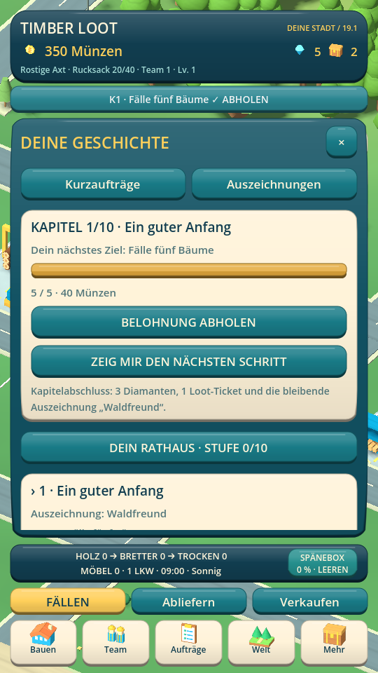

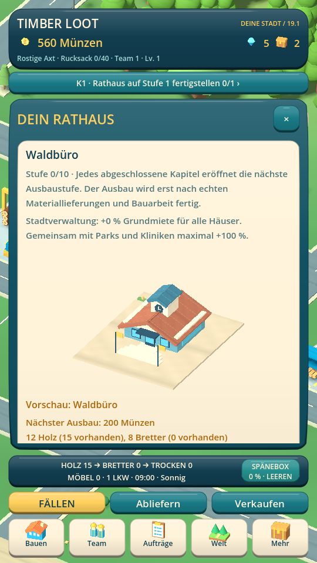

## Neu in 0.19 — Stadtgefühl und zehn Architekturstadien

- **Alle 14 Stadtgebäudetypen besitzen zehn tatsächliche, unterscheidbare 3D-Ausbaustufen**. Wohnhäuser werden zu Hochhäusern, Hotels zu Resorts, die Feuerwache zur zentralen Hauptfeuerwache und die Rettungsstation zum Krankenhaus beziehungsweise Klinikum. Landhäuser, Villen, Läden, Büros, Schulen, Polizei, Taxis, Nachtclubs und Parks entwickeln ebenfalls ihre eigene Architektur. Grundrisse und gespeicherte Positionen bleiben gültig. Ein bezahlter Ausbauplan verändert das fertige Gebäude erst nach tatsächlichem Bauabschluss.
- **Gebäudekarte unten** beim Antippen in der Welt, mit Zustand, Materialien, Ausbau und Miete. Am Griff hochwischen öffnet die ausführlichen Details. Gebäude bleiben im oberen Weltbereich sichtbar; auch die oberen Etagen hoher Häuser lassen sich antippen. Unter „Stufen 1–10“ zeigt eine eigene 3D-Vorschau die tatsächlichen Modelle.
- **Materialhilfe mit direkter Aktion**: fehlende Materialien antippen, tatsächlichen Lagerbestand, lokale Produktionsausgänge und beladene LKWs ansehen, zum passenden Betrieb oder Bauplatz springen. Gemeinsam genutzter Lagerbestand wird nicht als weiterer privater Fabrikbestand dargestellt. Baustellen zeigen angekommen, unterwegs und noch fehlend getrennt.
- **LKWs antippen und ihre echten Lieferwege markieren**. Die Karte zeigt tatsächliche Ladung, Ursprung, Ziel, Arbeitszustand und eine begrenzte Ankunftsschätzung. Eine leere Rückfahrt bleibt leer; wartende Entladung wird ausdrücklich angezeigt. Die Darstellung verändert keine Warenbestände.
- **Bauen öffnet eine horizontale Wischpalette**, während die Welt sichtbar bleibt. Kategorien für Produktion, Stadt, Versorgung und Wege. Ein kurzer Tipp beginnt die reale Vorschau; Wischen kauft nichts. Ausrichtung und Position lassen sich vor Bestätigung zurücknehmen. Der vollständige Katalog bleibt zusätzlich erreichbar.
- **Straßen in einer Fingergeste zeichnen**, Kurven wechseln, Preis prüfen und bestätigen. Die letzte unbenutzte selbst gebaute Strecke lässt sich mit exakt erstatteten Baukosten zurücknehmen. Aktive Fahrzeuge, Bewohnerwege, Haltestellen und Buslinien bleiben geschützt; wiederholtes Rücknehmen erzeugt kein Geld.
- **Viertel aufziehen, benennen und gemeinsam ausbauen**. Ein Viertel umfasst die tatsächlichen Gebäude innerhalb seines Bereichs. Der Ausbauplan zeigt sämtliche Kosten und Materialien vor der Bestätigung; ein veränderter Preis oder zu wenig Geld startet keinen Teilauftrag. Neue Aufträge warten weiterhin auf reale LKW-Lieferungen; freie Bauarbeiter wechseln automatisch zum nächsten Viertelauftrag. Das Entfernen der Markierung entfernt keine Gebäude.
- **Antippbare Übersichtskarte** für Betriebe, Häuser, Baustellen, freie Grundstücke, Waldregionen, Lieferwege und gesperrte Stadtviertel. Regionen zeigen ihre wirklichen bestehenden Erschließungsvoraussetzungen und Kosten. Die Weltgröße und bestehenden wirtschaftlichen Freischaltungen bleiben erhalten.
- **Ruhige Ereigniszentrale** statt zusätzlicher Pflichtfenster: Bauabschlüsse, fehlende Materialien, fehlendes Personal, volle Ausgänge und laufende Stadtdienste. Tatsächliche Bauabschlüsse werden auch während der Offline-Simulation gespeichert. Benno reagiert auf konkrete fertige Gebäude und verlinkt bei Problemen zu passenden Aktionen.
- **Rückmeldung und Lesbarkeit**: kurze Lieferanzeigen bei tatsächlicher Entladung, vorhandene Baufeiern, UI-Sounds, optional abschaltbare Vibration, größere Schrift, starker Kontrast und reduzierte Effekte. Zahlen, Symbole und Zustandstexte ergänzen Farben. Stadtbeschriftungen werden in der weiten Übersicht zurückgenommen. Einstellungen überstehen Speichern und Prestige.
- Gleiches Paket, gleicher Testschlüssel, gleicher Speicherpfad und Schema 1; Android-Code **1900**. Ausschließlich `android.permission.VIBRATE` für die freiwillig einschaltbare Vibration. Keine Netzwerk- oder Speicherberechtigungen. **Als Update installieren, vorher nicht deinstallieren.** Echte Android-Touch-, Vibrations- und Leistungstests dieser Version stehen aus.

Die vollständige Zuordnung der zwölf UX-Wünsche steht in [UX-Prüfliste](docs/UX-CHECKLIST.md). Weitere Sand-/Metall-/Betonketten und die übrigen offenen Master-Phasen stehen weiterhin im [Industrie-Masterplan](docs/INDUSTRY-ROADMAP.md).

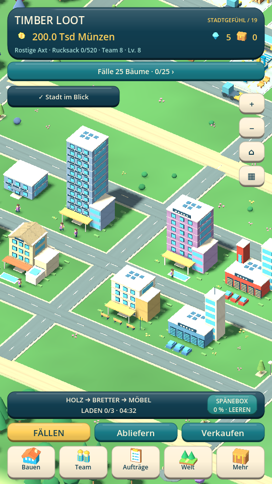

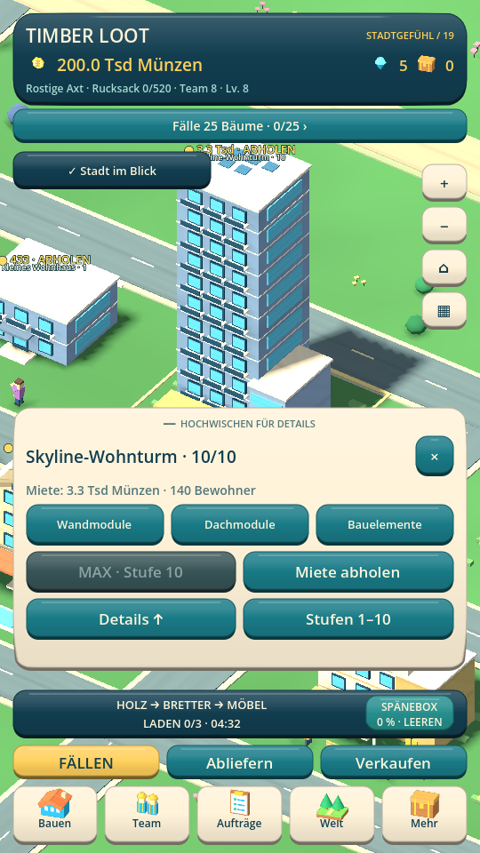

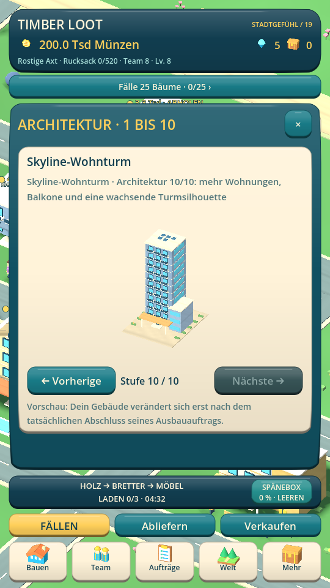

## Korrektur 0.18 — Material kommt wirklich auf der Baustelle an

- Baustellen holen benötigtes Holz, Bretter und Möbel direkt an den Ausgängen der aktiven Holzlinie ab. Fertige Bausteine und Kies können direkt am Steinwerk geladen werden. Andere Materialien kommen weiterhin aus dem gemeinsamen Lager. Jeder Abtransport entnimmt seinen tatsächlichen Bestand genau einmal; erst Entladen erhöht den Baustellenvorrat.
- Neue Materialbaustellen bestellen ab Level 4 automatisch, statt bis Level 10 auf die globale Automatik zu warten. Schon bezahlte alte Projekte werden beim Update dafür freigeschaltet; Pause, Materialrechnung, Baufortschritt und laufende Ladungen bleiben erhalten. Benötigte Ausgänge gehen vor neuen nachgelagerten Fahrten an den Bau. Die gekaufte Flotte bleibt das gemeinsame Limit.
- Ein JSON-Ladefehler ließ ausgewählte Gebäude gleichzeitig in der Holzlinie und in der alten gemeinsamen Wirtschaft produzieren: gespeicherte Referenzen wurden als Fließkommazahlen geladen und nicht als dieselben Gebäude erkannt. Numerischer Referenzvergleich erhält jetzt die exklusive Zuordnung; vorhandene Bestände werden nicht gelöscht oder neu erfunden.
- Sägewerk und Möbelfabrik zeigen **Eingang und Ausgang in getrennten festen Zeilen**. Das Holzsymbol wechselt bei vollem Bretterausgang nicht mehr zum Brett und zurück. Fahrzeuge zeigen Ladungsziel beziehungsweise **LEER · zurück**; getrennte Render-IDs verhindern einen Modelltausch zwischen verschiedenen Lieferarten.
- Im Baustellenmenü stehen tatsächlich unterwegs befindliche Mengen, Ursprung und Ziel sowie Hinweise auf fehlende Ware, freie LKWs oder unverbundene Straßen. Kein versteckter automatischer Transfer von lokalen Puffern ins Zentrallager mehr. Weitere fortgeschrittene gemeinsame Produktionspuffer werden durch diese Korrektur nicht zu individuellen LKW-Strecken.
- Android-Version 0.18.0-test, Code 1800, gleiches Paket, gleicher Testschlüssel und Speicherformat 1: **als Update installieren, vorher nicht deinstallieren**.

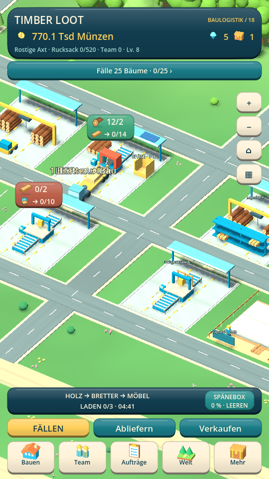

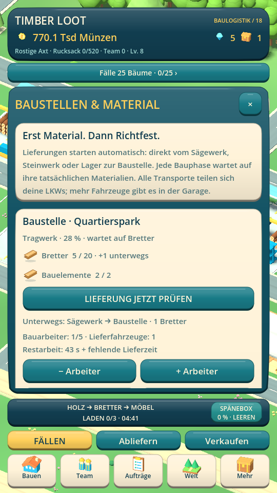

## Neu in 0.17 — Das erste Steinrevier

- Ab **Unternehmenslevel 5** frei platzierbare Steinbrüche und Steinwerke mit jeweils zehn Ausbaustufen. Der erste Bau benötigt vorhandenes Holz und Bretter, keine eigenen Steinprodukte. Deine Holzindustrie bleibt bestehen.
- Ein tatsächlicher Bagger pro Steinbruch: Gestein lösen → geladene Schaufel schwenken → Abholmulde beladen → Arm zurückführen. Auf Stufe 1 werden zwei Einheiten in einem sieben Sekunden langen Arbeitszyklus gewonnen. Vorkommen, Schaufel und Mulde besitzen getrennte gespeicherte Bestände. Volle Mulden stoppen den Abbau; erschöpfte Felsadern lassen sich für Spielmünzen neu erschließen. Baggerkapazität und Arbeitsgeschwindigkeit steigen mit dem Betriebsausbau.
- **Muldenkipper** fahren Gestein vom Steinbruch zum Steinwerk. Dort wählst du **3 Gestein → 5 Bausteine in 6 Sekunden** oder **3 Gestein → 4 Kies in 5 Sekunden**, vor Produktionsboni. Ein begonnener Auftrag wird zuerst fertiggestellt. Eingangsware gehört während der Verarbeitung dem gespeicherten Arbeitsauftrag; volle Ausgänge verhindern neue Aufträge.
- Fertige Bausteine fahren auf Paletten zum vorhandenen Lager, Kies in Kippern. Erst nach Entladung steht Material für Verkauf oder Baustellen zur Verfügung. Wird das Lager während der Fahrt gefüllt, wartet der beladene LKW am Ziel. Teilmengen, Rückfahrt, freie Kapazität und tatsächliches Transportgewicht werden berücksichtigt.
- Holzlinie, Steinkette und Materialbaustellen nutzen dieselbe Zahl gekaufter LKWs. Abwechselnde Vergabe verhindert, dass ein einzelner Starter-LKW eine Branche dauerhaft verhungern lässt. Mehrere Steinwerke können unterschiedliche Produkte herstellen. Kein neuer Förderbandverkehr.
- Steinbetriebe benötigen ab Ausbau 2 Bausteine und Kies; größere Holzindustrie-Upgrades ab Zielstufe 6 und Unternehmenslevel 5 bekommen ebenfalls solche Fundamente. Bereits bezahlte Baustellen werden unverändert fortgesetzt. Ein teurerer Baustoffhändler gegen Spielmünzen verhindert blockierende Abhängigkeiten; Geldbooster erzeugen beim Kaufen und Weiterverkaufen keinen Gewinn.
- **Bauen → Steinbruch & Baustoffe** oder **Mehr → Steinbruch & Baustoffe**: Standorte bauen, lokale Vorräte und Vorkommen ansehen, Produkt wählen, neue Felsader erschließen, Betrieb ausbauen und Notmaterial beschaffen. Materialicons und Füllstände erscheinen auch direkt über den Anlagen. Der neue Liefermeilenstein belohnt 50 ins Lager gebrachte Baustoffe.
- Die Bauvorschau zeigt vor dem Bezahlen den späteren Materialbedarf und den aktuellen Lagerbestand. Ein Fehler wurde behoben, der Stadt-Baupläne trotz freiem Platz blockierte, wenn Material erst nach Baubeginn per LKW ankommen sollte.
- Rezepte, Rohstoffmetadaten und Baggerzyklen stehen in [Economy/stone_industry.json](Economy/stone_industry.json). Die JSON-Datei ist ausdrücklich im Android-Paket enthalten. Simulation und Speicherung laufen unabhängig von sichtbaren Modellen; alte Schema-1-Spielstände erhalten keine erfundenen Mineralvorräte.
- Gleicher Testschlüssel und gleiches Paket, Versionscode 1700: als Update installieren. Sand, Metall, Beton, direkte Schaufelbeladung einzelner wartender LKWs sowie vollständige Fahrzeugidentitäten und Kollisionsverkehr bleiben weitere Master-Phasen.

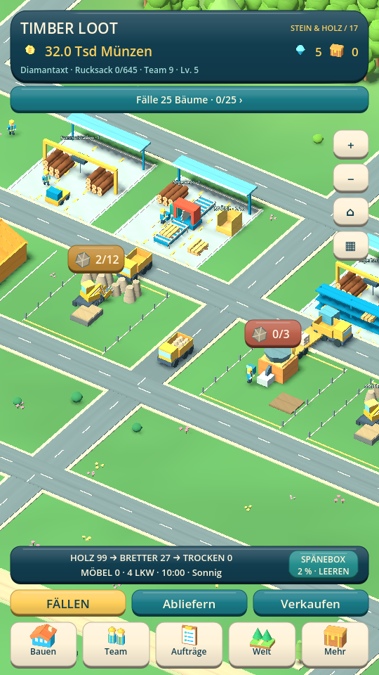

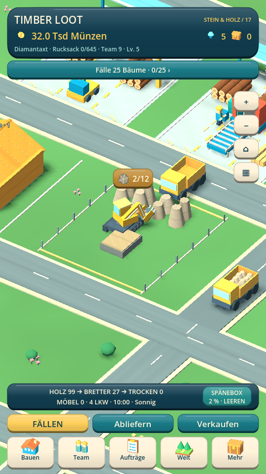

## Weiterhin aus 0.16 — LKWs und Stadtleben

- Die Förderstrecken zwischen den Gebäuden sind entfernt. **Holz → Bretter → Möbel → Laden** verwendet auf allen drei Teilstrecken tatsächliche Straßenfahrten. Die gesamte gekaufte Fahrzeugflotte wird gemeinsam mit Baustellen vergeben, einschließlich Beladen, Entladen und leerer Rückfahrt. Nachgelagerte Lieferungen haben Vorrang, damit bereits ein einzelner Start-LKW die ganze Kette bedienen kann.
- Pickup und LKW, ab Transportstufe 5 ein Gelenk-Auflieger, ab Stufe 7 ein Tiefbett mit Rampen. Holz, Bretter, Möbel und Materialkisten sitzen auf dem tatsächlichen Ladebereich; leere Rückfahrten zeigen keine Ladung. Ein Upgrade ersetzt auch schon aktive Fahrzeugmodelle. Kleine maschineninterne Rollentische bleiben Teil der Verarbeitung.
- Polizei, Feuerwehr, Rettungswagen und Taxis fahren echte Aufträge über das Straßennetz. Rettung und Gemeindehilfe haben einen Arbeitsaufenthalt am Ziel; Taxifahrgäste warten, steigen ein und werden an einem tatsächlichen Stadtziel abgesetzt. Abgeschlossene Fahrten sammeln Spielmünzen in der abholbaren Stadtkasse. Ohne eigene Wache kommt Hilfe von der bestehenden westlichen Zufahrt.
- Neue frei platzierbare **Polizeiwache und Taxizentrale**, jeweils mit eigener Gebäudeform. Eigene Feuerwehr und Klinik dienen den passenden Fahrzeugen als Ausgangspunkt; bessere Dienstgebäude erlauben mehr gleichzeitig verfügbare Fahrzeuge. Bis zu zwölf gespeicherte Bewohnerwege zwischen tatsächlichen Häusern und Zielen ergänzen die bisherigen Vorgartenszenen. Begrenzte wiederverwendbare Figuren-/Fahrzeugpools und der Akkumodus begrenzen die Darstellung.
- Direkter Zugang über **Stadt → Stadtleben & Fahrzeuge** oder **Mehr**. Dort Fahrten anfordern, Stadtkasse abholen, neue Fahrten ein-/ausschalten, Standorte bauen und Fahrzeuge ansehen. Erledigte Aufträge und laufende Wege überstehen Laden und Offlinezeit. Aktive Wege schützen ihre Straßen und Standorte bis zum Abschluss.
- Im Baukatalog und allen anderen Listen **direkt über Karten und Schaltflächen mit dem Finger wischen**. Eine Wischbewegung löst keinen Kauf aus; kurze Berührungen bedienen weiterhin die richtige Schaltfläche. Nachlauf, abgebrochene Touchgesten und kleine Hochformatfenster sind berücksichtigt. Die schmale Scrollleiste ist entfernt, die Kamera bleibt hinter dem Menü stehen.
- Alte gespeicherte Bandladungen werden verlustfrei zu ausstehenden Straßenlieferungen am Ausgang zurückgeführt, auch wenn der dortige Puffer voll ist. Bereits angekommenes Material wird nicht doppelt gebucht. Neue Auftragsfristen berücksichtigen die längeren Straßenfahrten. Gleiches Paket, gleicher Testschlüssel, Schema 1 und Android-Versionscode 1600: als Update installieren.
- Die fortgeschrittenen bisherigen Fabriken verwenden weiterhin ihre gemeinsamen Lager. Individuelle Transporte für deren gesamte Wirtschaft, Kollisionsverkehr, Kreuzungsampeln und die späteren Stein-/Stahl-/Betonketten bleiben weitere Schritte; diese Version behauptet keine vollständige Verkehrssimulation.

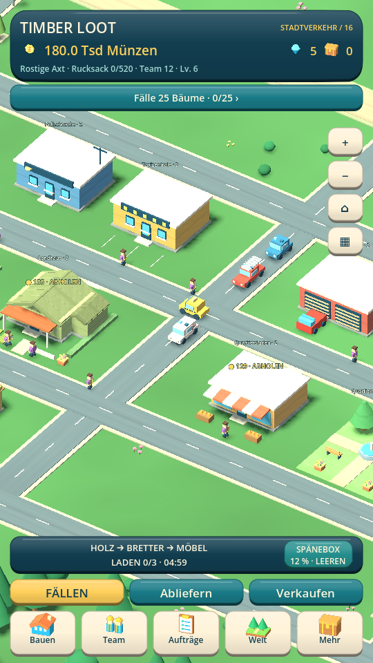

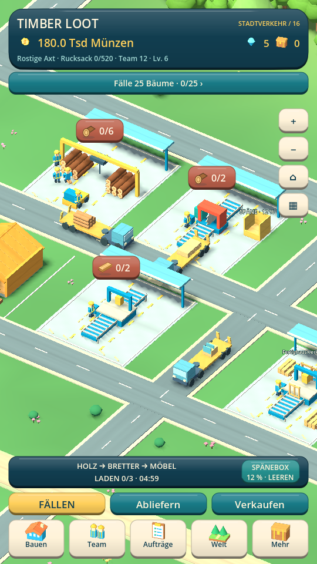

## Weiterhin aus 0.15 — Material wird wirklich geliefert

Die damaligen Bandfahrten sind seit 0.16 durch den oben beschriebenen Straßenverkehr ersetzt.

- Kleine spielbare Linie **Holz → Bretter → Möbel → Laden** unter **Aufträge → Lieferkette** eröffnen. Sie verwendet vorhandene Gebäude, eigene Puffer und die gekauften Transportfahrzeuge. Antippbare Materialzähler zeigen Leerstand, Teilmengen und volle Ausgänge direkt über den Gebäuden.
- Ladenaufträge mit Frist und Bonus. Verspätete Möbel verdienen 70 % des Verkaufspreises; der Auftrag bleibt erfüllbar. Kein echtes Geld und kein Game Over.
- Unternehmenslevel: einfache Geld-Upgrades auf Level 1–3; ab Level 4 Materialbaustellen mit sieben Bauphasen. Holz, Bretter, Muttern und Schrauben müssen tatsächlich am Bauplatz ankommen. Hardware gibt es gegen Spielmünzen im Materialdepot.
- Liefer-LKWs nehmen Ware am Lager auf, fahren über Straßen zur Baustelle, entladen und kehren leer zurück. Baustellen und Laden teilen sich den gekauften Fuhrpark. Pause, Priorität, Materialkauf, Baukamera, sichere Bauabbrüche und ein begrenztes zuweisbares Bauteam sind spielbar. Ab Level 10 kann die globale Baustellen-Automatik übernehmen.
- Sichtbare Baustellenschilder, Lieferflächen, wachsende Baugeometrie, arbeitende beziehungsweise wartende Bauarbeiter, Kran und Eröffnungsfeier. Ladungen und Bauphasen sind gespeichert und laufen unabhängig von der Darstellung weiter.
- Alte Spielstände und schon bezahlte Baustellen bleiben erhalten. Zusätzliche Fabriken behalten die bisherige fortgeschrittene Holz-/Stadtwirtschaft. Das ist der erste spielbare Abschnitt des großen Master-Plans; Stein-, Stahl- und Betonketten sowie die neuen Bergbaumaschinen stehen noch aus. Der genaue Stand und die weiteren Phasen stehen in [Industrie-Masterplan](docs/INDUSTRY-ROADMAP.md).

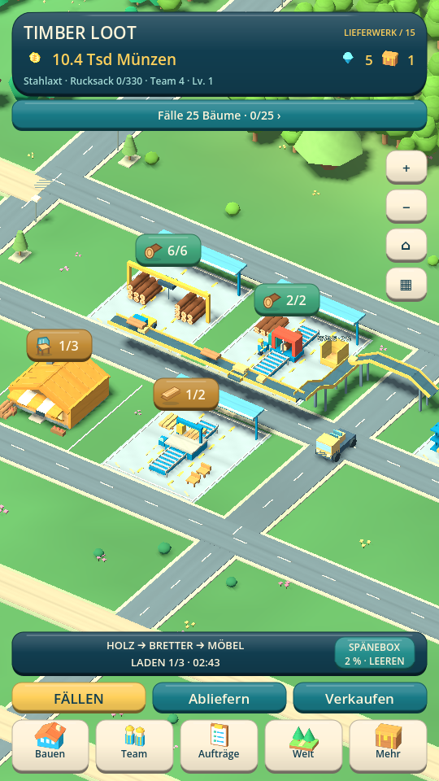

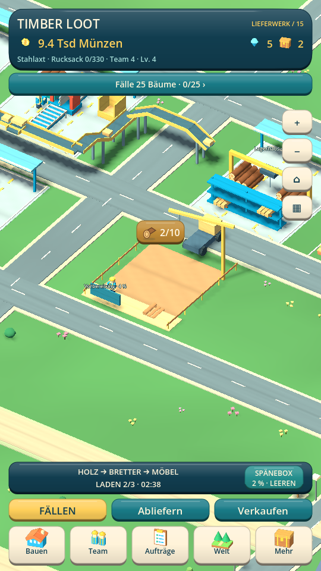

## Neu in 0.14 — Ein lebendiges Waldtal

- Das flache rechteckige Landschaftsbrett und die harten Biomplatten sind durch zusammenhängendes Gelände mit weichen Farbwechseln, unregelmäßigem Waldrand, Hügeln und flachen Ufern ersetzt. Ein geschwungener Bach, ein kleiner See, eine Holz-Fußgängerbrücke, ein Picknickplatz und ein Aussichtsturm geben dem Tal eigene Orte. Die weiterhin bebaubaren Flächen bleiben eben; gespeicherte Häuser und Straßen werden nicht versetzt.
- Zusätzlich bis zu 2.500 rein dekorative Bäume, Büsche, Steine und Blumengruppen. Sechs gemeinsame instanzierte Geometrien halten die Zahl der Zeichenaufrufe klein; Stämme haben ihre eigene Holzfarbe. Die 1.000 wirtschaftlich nutzbaren, nachwachsenden Bäume bleiben erhalten und bekommen unregelmäßige Waldformen und unterschiedliche Baumkronen.
- Vegetation verschwindet automatisch aus Gebäuden, Baustellen, Straßen, Haltestellen und Förderstrecken. Ein Haus in einer Wiese zu platzieren kostet dafür nichts zusätzlich. Deko erhöht weder Holzvorräte noch Arbeiterleistung und verändert keine Baukosten.
- Straßenränder erhalten kleine Pflanzungen. Wenig genutzte feste Zufahrten erscheinen als Schotterwege, belebte Straßen als Asphalt; Linien- und Lieferstrecken bleiben befahrbar. Die bestehenden Straßengraphen und eigenen Strecken sind unverändert. Leere Grundstücke tragen keine großen dauerhaften Farbplatten mehr.
- Kamerafehler beim starken Herauszoomen behoben: Die Kamera bewegt sich mit dem Zoom ausreichend zurück, sodass sie den Vordergrund nicht abschneidet. Die Übersicht bleibt näher am Ort; volle Welt und freie Zoomstufen bleiben erreichbar. Dünnere Nebelschicht, lesbareres Abendlicht und ruhigere Bodenfarben.
- Akkumodus zeichnet nur 45 % der zusätzlichen Landschaftsdekoration. Platzierung, Wirtschaft, alte Spielstände und Schema 1 bleiben erhalten. Android-Versionscode 1400 und derselbe Testschlüssel wie zuvor.

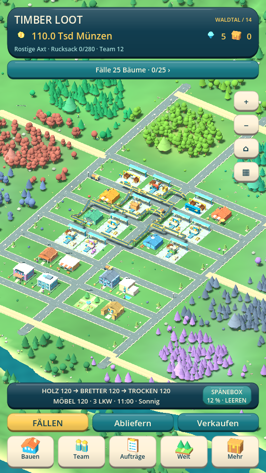

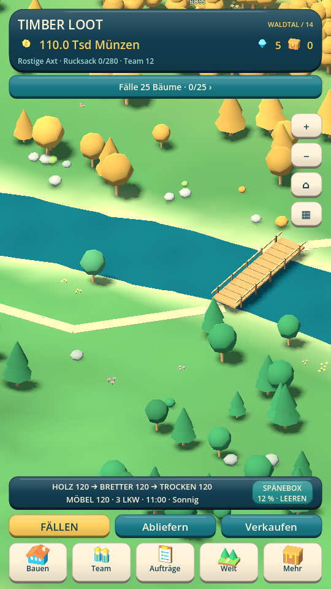

## Weiterhin aus 0.13 — Vom Holzlager zur Kleinstadt

- Zusammenhängendes Land von 640 × 560 Einheiten. Nach den drei bisherigen Regionen und 20 Bewohnern erschließt du Ost- und Westviertel: jeweils zwölf zusätzliche Hausgrundstücke, acht weitere Industriebetriebe und eine Zufahrt. Insgesamt bis zu 36 Stadtgrundstücke und 40 Betriebe; bisherige Positionen bleiben erhalten.
- Eigene Asphaltstraßen und Fußwege: Start und Ziel auf der Karte wählen, rechtwinklige Kurve wechseln, Kosten prüfen und bestätigen. Straßen schließen am vorhandenen Netz an; Gebäude, Baustellen, nicht erschlossene Viertel und Wasser werden geprüft. Abbrechen ist kostenlos. Strecken bleiben im Spielstand und lassen sich ohne Erstattung entfernen; aktive Busverbindungen sind geschützt.
- Eigene Formen für zwölf Stadtgebäude, darunter Feuerwehr mit Fahrzeughalle und Löschwagen, Wohnhaus mit Balkonen, Landhaus mit Veranda, Villa mit Pool, Laden mit Auslage, Schule, Gesundheitszentrum, Hotel, Bürohaus, Park und neuer Nachtclub. Größere Ausbaustufen erhalten mehr Etagen beziehungsweise zusätzliche Ausstattung. Vorgartenspaziergänge meiden den Villenpool.
- Goldene Mietanzeigen über Häusern zum Antippen, Abholung am Haus oder für die ganze Stadt. Neue Profile sammeln Miete im Hauskonto, auch während der maximal acht Offline-Stunden. Für 2.500 Münzen, angepasst an Prestige, übernimmt ein Hausverwalter die automatische Auszahlung. Alte Spielstände behalten ihre bisherige automatische Miete kostenlos.
- Bis zu acht frei gesetzte Haltestellen und drei Buslinien mit selbst gewählter Stationsreihenfolge. Sichtbare Busse fahren auf dem tatsächlichen Straßengraphen, halten vier Sekunden und öffnen die Türen; Bewohner warten am Unterstand. Abgeschlossene Rundfahrten verdienen einen nach Einwohnerzahl begrenzten Fahrpreis abzüglich Betriebskosten. Route, Fahrstand und Ertrag werden gespeichert und offline weitergerechnet. Unterbrochene Strecken bringen keine Fahrgelder.
- Werkzeugstufen 11–15 zeigen jetzt Mini-Forstmaschinen, Harvester und schwere Bagger mit bewegtem Arm, Säge und Holzladung. Arbeitsstreifen halten die Modelle sichtbar. Transportstufen zeigen Handwagen, Schubkarre, Pickup, LKW und schwere Forsttransporter. Bereits gekaufte Stufen erscheinen nach Laden ohne erneuten Kauf. Die bestehenden Leistungswerte bleiben erhalten; die Maschinen sind eine begrenzte szenische Darstellung des Gesamtteams.
- Direkter Zugang zu Straßen und Busverkehr im Baukatalog und in der Stadt; neue Meilensteine für Wege, Mietabholung, Busfahrten und Viertel. Förderstrecken verbinden auch Betriebe in den neuen Gebieten und überbrücken eigene Straßen.
- Android-Versionscode 1300, gleiches Paket, gleicher Testschlüssel und Schema-1-Spielstand. Als Update installieren, ohne vorher zu deinstallieren.

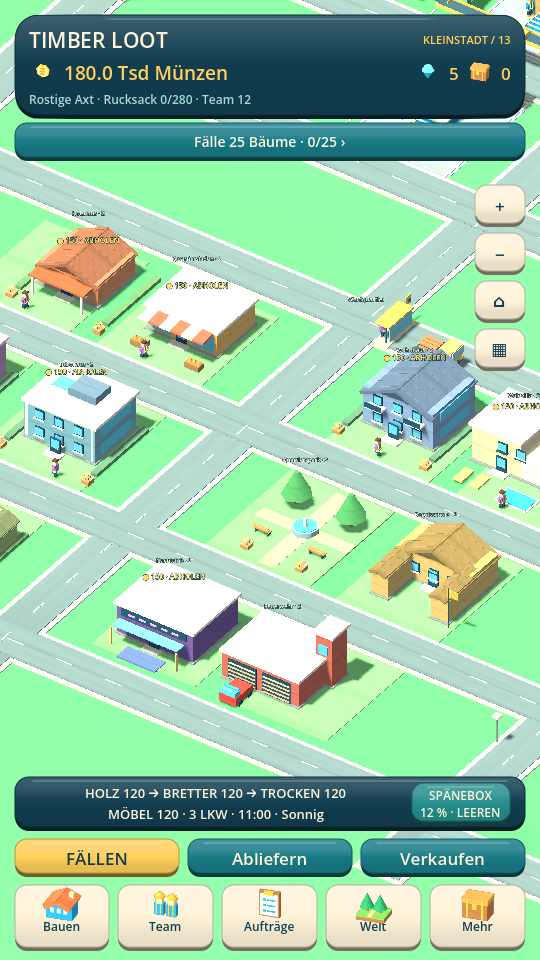

## Weiterhin aus 0.12

- Hütten erhalten Bank, Tisch mit Tasse und Brotdose, Sonnenschirm, Blumen und eine leuchtende Laterne. Parks haben richtige Bänke und zusätzliche Pflanzkübel. Die Dekoration bleibt innerhalb der bestehenden Grundstücke und dreht sich mit dem Gebäude.
- Ab vier dargestellten Mitarbeitern besucht ein Mitglied des sichtbaren Teams den Hütten-Pausenplatz. Es geht über den freien Vorplatz zur Bank, sitzt mit einer Tasse und kehrt wieder zurück. Der Mitarbeiter wird aus der bestehenden begrenzten Teamdarstellung genommen, es entsteht kein zusätzliches Personal.
- Arbeiter und Bewohner winken einander bei Begegnungen zu. Abstandsprüfung und Abklingzeit begrenzen die Gesten. Bewohner gehen im Vorgarten ihres tatsächlich gespeicherten Hauses spazieren und folgen auch dessen Rotation.
- Echte Bauabschlüsse lösen einen kurzen Eröffnungs-/Ausbaujubel mit Konfetti, Beschriftung und leiser Dreitonfolge aus. Eine begrenzte nahe Gruppe hebt die Arme. Reine Bauaufträge oder geladene Bestandsgebäude lösen keine Feier aus; mehrere Effekte verwenden einen festen Pool.
- Akkumodus reduziert Partikel und Zuschauer. Unter Mehr → Einstellungen lassen sich die neuen Alltagsszenen abschalten; diese Wahl bleibt beim Speichern und Prestige erhalten. Benno bleibt unabhängig einstellbar.
- Alltagsszenen sind eine szenische Darstellung; Pausen und Jubel verändern Produktion, Kosten, Lager oder Bauzeiten nicht. Es gibt weiterhin keine vollständige Fußgänger-/Fahrzeug-Kollisionssimulation.
- Update mit Versionscode 1200, gleichem Paket, Testschlüssel und Schema-1-Speicherdatei. Nicht vorher deinstallieren. Die vorherige Version 0.11 wurde vom Nutzer als auf seinem Handy funktionierend bestätigt; dies ersetzt keinen Gerätetest der neuen 0.12.

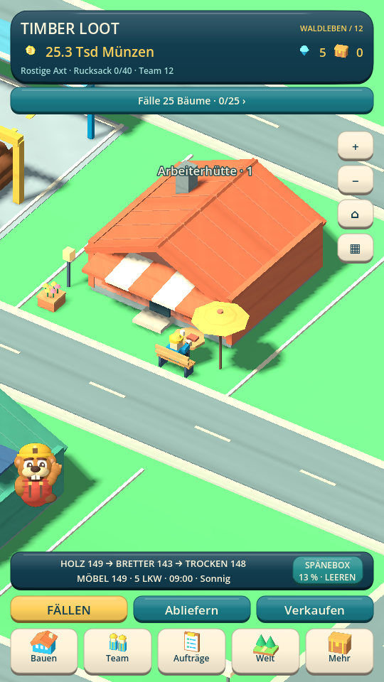

## Weiterhin aus 0.11

- Benno, ein eigener animierter 3D-Biber mit Helm, rotem Hemd, großen Zähnen, Blinzeln und Winken. Deine bereitgestellte Biber-Grafik erscheint unverändert im Willkommensbildschirm; der kleine Begleiter ist ein separates, vereinfachtes 3D-Modell.
- Einmalige Begrüßung beim Start und nach längerer Rückkehr, mehrere freundliche Texte sowie die tatsächlich berechneten Offline-Einnahmen. Ein alter Offline-Bericht wird nicht bei jeder erneuten Begrüßung wiederholt.
- Benno freut sich über fertiggestellte Betriebe, Häuser, Upgrades, neue Regionen, Prestige und besonderen Loot. Ein Bauauftrag allein gilt nicht als fertiges Gebäude. Eine einzelne vorgemerkte Reaktion und Zeitabstände verhindern eine Flut alter Meldungen.
- Antippen zum Plaudern; Hinweise berücksichtigen Rucksack, Spänebox, Trocknung und Stadt. Wo passend führt ein Link direkt ins zugehörige Menü. Automatische Tipps werden pro Hinweis und Sitzung nur einmal gezeigt, Sprechblasen lassen sich sofort schließen.
- Begleiter und Sprechblasen bleiben in Menüs und im Baumodus verborgen. Benno lässt sich unter Mehr → Einstellungen abschalten; die Einstellung bleibt beim Speichern und Prestige erhalten. Das kleine Portrait rendert mit begrenzter Bildrate und pausiert in verdeckten Ansichten.
- Unveränderte Wirtschaft und Schema-1-Speicherdatei, Paket und Testsignatur. Android-Versionscode 1100; als Update installieren.

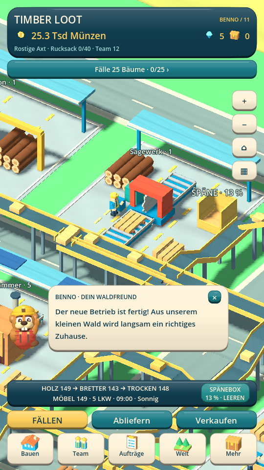

## Weiterhin aus 0.10

- Plastische Oberfläche mit gewölbten Farbflächen, Lichtkante, schmaler Seitenkante und verändertem Druckzustand. Alle Menüs, Baukarten und Aktionsflächen verwenden die neue gemeinsame Oberfläche.
- Echte eigene 3D-Modelle für die fünf Hauptmenüs sowie Münzen und Diamanten. Ein isolierter 896×128-Viewport rendert alle sieben Symbole gemeinsam einmal; die Oberfläche verwendet Ausschnitte dieses Bildes. Nach Rückkehr aus dem Hintergrund wird neu gerendert, ohne ständige zusätzliche 3D-Pässe im laufenden Spiel.
- Räumliche Schatten für Gebäude, Maschinen, Arbeiter und Förderbänder im Standardmodus. Akkumodus deaktiviert sie. Neutralere Beleuchtung sowie unterschiedliche Rauheit von Holz, Lack und Metall geben den Anlagen mehr Tiefe.
- Bestehende 0.7/0.8/0.9-Spielstände, Paketkennung und Testsignatur bleiben erhalten. Android-Versionscode 1000. Es gibt keine Zielgröße von 55 MB und keine künstliche Vergrößerung: Die Ressourcen werden nach sichtbarem Nutzen ausgewählt.

## Weiterhin aus 0.9

- Offene Fabrikflächen mit eigenen Maschinenmodellen: Säge mit Blatt und Stammzufuhr, Trocknungsanlage, Möbel-/Bauelement-Arbeitsplätze, Papier- und Pelletanlagen. Große Holzstapel mit sichtbaren Stirnflächen, Bretterpaletten, Möbel, Lagerregale, Steuerpulte und Arbeitsmarkierungen ersetzen die geschlossenen Fabrikhäuser.
- Werkstücke fahren über Rollenbahnen; Säge und Werkzeugköpfe laufen abhängig vom tatsächlichen Produktionsfluss ihres Betriebs. Pause und Materialmangel stoppen die Bewegung. Bestände neben der Verarbeitung reagieren auf die gemeinsamen Ressourcenvorräte. Diese Anzeige ergänzt die Wirtschaft, sie simuliert keine einzelnen physischen Werkstücke oder getrennten Betriebslager.
- Helm, Warnweste, bewegte Arme und Beine: Ein Teil des eingestellten Teams bedient sichtbar die Maschinen, der Rest transportiert im Wald. Die bestehenden Leistungswerte bleiben erhalten; die Rollenverteilung ist eine begrenzte visuelle Darstellung.
- Kompakter Kopfbereich, kleinere Aktionsleiste und eigene orange Symbole auf hellen Navigationstasten. Näherer Einstieg auf die Industrie; Weltübersicht und freie Kamera bleiben erreichbar.
- Android-Versionscode 900. Paket, Testsignatur und Schema-1-Spielstand bleiben wie bei 0.7/0.8. Als Update installieren, ohne vorher die App oder ihre Daten zu löschen.

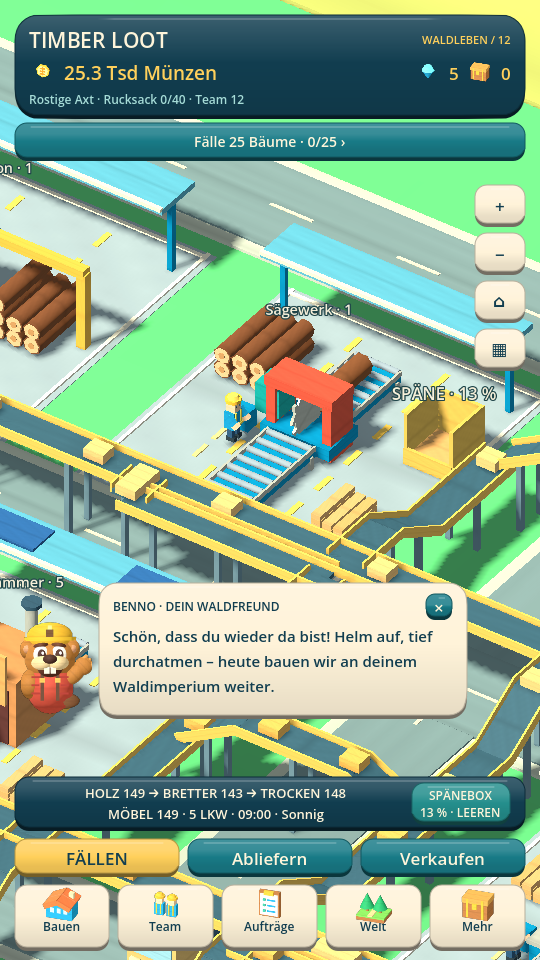

## Weiterhin aus 0.8

- Kräftigere Farben, unterscheidbare Betriebsdetails, helle Menükarten, direkter Baukatalog mit Produktion/Wohnen/Versorgung und mehr Platz auf hohen Handybildschirmen.
- Neue Gebäude in der Welt platzieren und in 90°-Schritten drehen. Grüne/rote Vorschau, Prüfung gegen Straßen und andere Gebäude, keine Bezahlung vor Bestätigung. Bestehende Betriebe und Häuser kostenlos verschieben; Positionen und Bauaufträge bleiben gespeichert. Der Baumodus nutzt das zentrale Baugebiet innerhalb der Hauptstraßen.
- Sichtbare automatisch geroutete Förderstrecken umgehen Gebäude und überbrücken Straßen. Güter bewegen sich bei aktiver Produktion. Die Wirtschaft verwendet weiterhin gemeinsame Materialpuffer; Förderstrecken sind keine zusätzliche Waren- oder Stausimulation.
- Spänebox mit Füllstand am Sägewerk und direktem Zugriff unten. Bestand manuell leeren und verkaufen oder für Pellets/Papier halten. Bei voller Box bleibt der gespeicherte Vorrat erhalten; nur neu anfallender Überlauf wird kompostiert. Optional lässt sich dieser Überlauf stattdessen verkaufen. Die Bretterproduktion stoppt deswegen nicht mehr.
- Willkommen und vier praktische Einführungsschritte für neue Profile. Bestehende 0.7-Spielstände behalten ihren Fortschritt und bekommen keine verpflichtende Einführung. Hilfe ist unter Mehr erreichbar.
- Betrieb antippen: Produktionszustand, Ausbau und Verschieben direkt erreichbar. Nebel schwächer, korrigierte Ganzzahlanzeigen, Schutz vor doppelten emulierten Mausklicks auf Touchgeräten.

## Spielumfang

- Zusammenhängendes natürliches Gelände um die unveränderten Bauflächen von 640 × 560 Einheiten, zehn Biome, 1.000 instanzierte Bäume, zehn sichtbare Bossbäume. Straßen und Projektzufahrten bleiben auf Land. Bäume wachsen nach; Holzfäller sind in begrenzter Anzahl sichtbar.
- Bis zu 40 frei platzierbare Industriebetriebe, mehrere Betriebe desselben Typs und unabhängige Upgrades. Sammelstation, Lager, Hütten, Sägewerke, Trocknung, Möbelfabrik, Garage, Forschung, Fertighauswerk, Tischlerei, Pellet-, Papier- und Designmöbel-Produktion.
- Echte Ressourcenbilanzen, faire gemeinsame Materialzuteilung, sichtbare Straßenladungen und arbeitende Sägen, Bauzeit, Gerüste und Kräne. Bestehende Betriebe produzieren während Upgrades weiter.
- Bis zu 36 Stadtgrundstücke in drei Regionen und zwei zusätzlichen Vierteln. Vierzehn Gebäudetypen einschließlich Polizeiwache und Taxizentrale: Holzhaus, Landhaus, Laden, Wohnhaus, Villa, Hotel, Büros, Nachtclub, Park, Schule, Klinik, Feuerwehr. Bis Stufe zehn, Miete, Bewohner und öffentliche Boni.
- Materialplaner für ein Stadthaus: Bestände und Kosten, Schutz vor automatischem Verbrauch, optional genau ein automatischer Bauauftrag. Manuelle Verkäufe bleiben möglich.
- Fünf Großprojekte mit je drei bezahlten Bauabschnitten und anschließendem laufenden Ertrag. Standortmodelle und Zufahrten sind sichtbar.
- 15 Werkzeug- und zehn Fahrzeugstufen; Mitarbeiter, automatische Möbel-Exporte, wiederholbare Lieferaufträge, elf Meilensteine, fünf Forschungsrichtungen.
- Sechs Loot-Seltenheiten mit offen angezeigten Wahrscheinlichkeiten. Werkzeug- und Fahrzeugteile sind zum Herstellen verwendbar; freigeschaltete Skins lassen sich anlegen. Münzen, Diamanten, Tickets, Geldscheine und Mythic Tokens werden gespeichert; Tokens verbessern dauerhaft die Loot-Chance. Geldscheine dienen derzeit als Auftragszähler/Vorratswährung.
- Zeitlich begrenzte Booster, steigende Prestige-Kosten und dauerhafte Geld-, Produktions- und Loot-Boni. Permanente Währungen, Inventar und Skins überstehen den Neustart; der Prestige-Hain benötigt eine vorherige Ära.
- Tageszeit, Regen, Nebel, Holzsplitter-Pool und Originalsounds. Akkumodus reduziert dargestellte Arbeiter, LKWs und Wettereffekte; Wälder verwenden MultiMeshes und statische Modelle zusammengefasste Geometrie.
- Versionierter Spielstand, atomare Übernahme, Backup-Fallback, Hintergrund-Speicherung und bis zu acht Stunden deterministischer Offline-Fortschritt.

## Erste Schritte

1. **Fällen** zeigt den aktiven Wald und füllt den Rucksack. **Abliefern** bringt Holz ins Lager und zeigt die Industrie. Antippen im Wald funktioniert ebenfalls; Ziehen und Zwei-Finger-Zoom bewegen die Kamera.
2. Holz und Bretter unter **Verkaufen** handeln, Missionen abholen und eine Trockenkammer sowie Möbelfabrik unter **Bauen → Produktion** beauftragen.
3. Mitarbeiter und Lager ausbauen. Möbel werden durch LKWs automatisch exportiert. Fördergüter bewegen sich nur bei aktiver Produktion des jeweiligen Betriebs.
4. Fertighauswerk bauen. Unter **Stadt → Grundstück** ein Holzhaus als Bauziel vormerken. Nach Lieferung und Fertigstellung bringt es Miete und Wohnraum. Die goldene Anzeige über dem Haus oder Stadt → Mieten holt Erträge ab; der Hausverwalter automatisiert das. Weitere Fabrikzweige, Regionen und Projekte öffnen den nächsten Ausbau.

5. Unter **Bauen → Straßen & Wege** eigene Strecken anlegen. Im Busmenü zwei Haltestellen an Straßen bauen, in Fahrreihenfolge auswählen und den ersten Bus kaufen. **Stadt → Regionen & Projekte** erschließt später weitere Viertel.

Die automatisierte Progressionsprüfung erreicht das erste Haus aus einem frischen Profil ohne geschenkte Ressourcen nach 1.682 simulierten Sekunden. Dies ist ein einzelner geprüfter Spielpfad, keine Langzeit-Balance-Zusage.

## Prüfung und Grenzen

`bash scripts/test.sh` verwendet temporäre Spielstände: 220 Regelprüfungen, ein frischer Verlauf bis zum ersten Haus, 4.092 Szenen-/Geometrieprüfungen, 56 Platzierungs-/Tutorialprüfungen und 42 Prüfungen der offenen Produktion, Schattenumschaltung und Bildschirmaufteilung sowie 23 Begleiter- und 30 Alltagsszenenprüfungen sowie 216 Stadt-/Straßen-/Busprüfungen, 177 Landschaftsprüfungen und ein abschließender Headless-Start. Eine zusätzliche OpenGL-Prüfung testet die sieben wirklich gerenderten 3D-Symbole, Transparenz, Beleuchtung, getrennte Szenen, Druckzustand und erneutes Zeichnen nach Rückkehr aus dem Hintergrund (23 Prüfungen einschließlich 3D-Biber und sichtbarer Winkeanimation). Neun zusätzliche OpenGL-Prüfungen prüfen tatsächliche Landschaftsfarben, sichtbares Wasser, den gerenderten Pflanzenpuffer nach Verschieben eines Gebäudes und den Vordergrund bei weitem Zoom. [Prüfbericht](docs/VALIDATION.md). Die Bilder unter `docs/` stammen aus dem Spiel; die Stadtansicht verwendet ausdrücklich einen nur für das Bild aufgebauten Demonstrationsstand.

Noch offen: reale Android-Gerätetests für Touch, Safe Area, Hintergrund, Temperatur und Akku; 50-Stunden-Balancing, Barrierefreiheit, Release-Signierung, iOS und Store-Abnahme. Immobilienverkauf/Umbau, frei vom Spieler formbares Wasser/Gelände, Autobahnen, vollständige Bahn-/Schifffahrt und eigene Musik pro Biom sind noch nicht enthalten. Busse fahren berechnete Routen mit vereinfachter Einwohnernachfrage, ohne vollständige Kollisions-/Stausimulation. Die sichtbaren Transportstufen fahren den bisherigen gemeinsamen Export-Rundkurs; sie routen noch keine individuellen Warenaufträge. Förderbänder nutzen weiterhin gemeinsame Ressourcenpuffer. Geldscheine und einige seltene Baupläne haben noch keinen eigenen Ausgabepfad. Großprojekte verwenden Standortmodelle; es gibt noch keinen echten Hafenverkehr. Keine Werbung, In-App-Käufe oder Cloud-Spielstandsynchronisierung.

## Sicherung

Jeder geprüfte Meilenstein erhält einen Git-Commit und wird nach `origin/main` übertragen. Ein lokaler Commit alleine ist keine externe Sicherung. `scripts/backup.py` erstellt zusätzlich ein Quellarchiv und ein vollständiges Git-Bundle außerhalb des Checkouts. Die ZIP enthält Quellcode ohne APK; das Bundle enthält die ganze Git-Historie einschließlich der separat gespeicherten Test-APK. Der externe Sicherungsstand wird durch erneutes Abrufen und Vergleich des Commit-Hashes geprüft.

Keine Zugangsdaten, privaten Signaturschlüssel, Spielstände oder Build-Caches gehören in Git.
