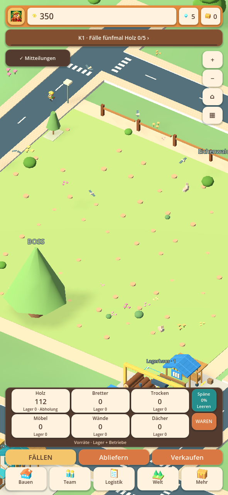
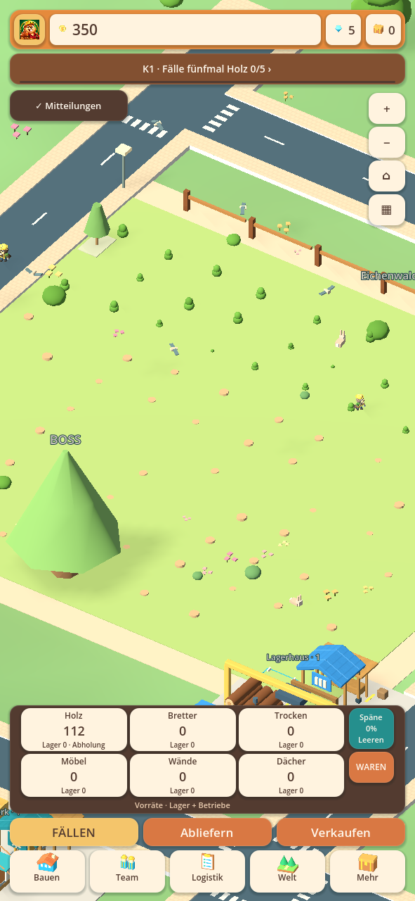
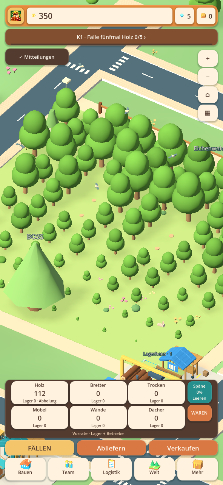

# Nachwuchs im aktiven Wald · 0.28.19-alpha.1

Der Wechsel zwischen Waldflächen war nicht das einzige Problem. Die Aufforstung
benutzte weiterhin nur den ursprünglichen Zugang. Hinter Maschinenflächen oder
bei einem zugebauten Eingang blieben freie Pflanzstellen unerreichbar. Außerdem
beschleunigten Forstforschung und Turbo bisher das Fällen, während Pflanzreisen
und Wachstum weitgehend unverändert blieben. Bei hoher Fällleistung wurde neuer
Nachwuchs dadurch sofort wieder verbraucht.

## Änderungen

- Freie Seitenzugänge und andere Anlaufrichtungen werden geprüft, wenn der
  bisherige Pflanzweg versperrt ist. Gebäude und Maschinen werden umgangen;
  tatsächlich belegte oder vollständig eingeschlossene Flächen bleiben gesperrt.
- Jede neue Pflanzmission speichert ihren tatsächlich gewählten Weg. Die Biber
  laufen und kehren auf diesem Weg zurück. Bauplatzprüfungen schützen denselben
  Weg. Alte Missionen ohne gespeicherten Weg behalten ihren ursprünglichen Pfad.
- Die automatische Teamverteilung kann bei stark abgeerntetem Wald bis zu
  90 Prozent des vorhandenen Teams zur Aufforstung einsetzen. Bei mehreren
  Helfern bleibt mindestens einer zum Fällen verfügbar. Ein einzelner Helfer
  übernimmt wie bisher zeitweise die Pflanzarbeit. Manuelle Zuweisungen bleiben.
- Turbo-Arbeiter beschleunigen Anreise, Pflanzarbeit und Rückreise neuer
  Pflanzmissionen. Die Forstforschung beschleunigt auch die Pflanzarbeit und
  verkürzt das Wachstum: `45 / (1 + 0,15 × Forschungsstufe)` Sekunden, mit einer
  technischen Untergrenze von 12 Sekunden. Ohne Forschung bleiben es 45 Sekunden;
  auf Forschungsstufe 10 sind es 18 Sekunden.
- Bestehende Missionen behalten ihre gebuchten Zeiten, bereits wachsende Bäume
  ihre gespeicherten Fristen. Neue Boni gelten für neu vergebene Missionen und
  tatsächlich neu gepflanzte Bäume. Kein Neustart eines Wachstumszählers.
- Die Waldübersicht unterscheidet freie Pflanzstellen und gesperrte Stellen.
  Forschungsbeschreibung und Teammenü erklären die zusätzlichen Forstwirkungen.

Die wechselnde Versorgung des Starterfeldes aus 0.28.18 bleibt erhalten. Wachstum
und Pflanzanimationen füllen keine Warenlager. Erst wirklich gefällte reife Bäume
liefern Holz. Eine volle Abholstation stoppt weiterhin die Ernte, aber nicht die
Aufforstung. Es werden keine zusätzlichen Helfer erfunden.

## Prüfung und Grenzen

Der später gemeldete Teambildschirm zeigt zehn zugewiesene Helfer, aber null
Pflanzmissionen und 95 offene Eichenwaldstellen. Ein zusätzlicher generierter
Fall bildet genau diese Zahlen mit einem versperrten alten Eingang nach:
vorher null nutzbare Wege, jetzt zehn tatsächlich startende Pflanzmissionen und
95 wieder ausgewachsene freie Stellen nach 240 simulierten Sekunden. Keine
Waren werden durch die Wiederaufforstung gutgeschrieben. Das ist eine
Reproduktion des beobachteten Symptoms, kein eingelesener privater Spielstand.

In der generierten Ausgangskonfiguration waren 93 Eichenwaldstellen physisch
frei, mit dem alten einzelnen Anlaufweg aber nur 81 erreichbar. Die freien
93 Stellen besitzen nun geprüfte Wege. Zusätzliche Fälle decken einen zugebauten
Eingang, vollständig eingeschlossene Bäume, geänderte Bauflächen, reservierte
Ausweichwege sowie alte und neue Missionsformate nach Speichern/Laden ab.
Die früheren Unzugänglichkeits-Fixtures verwenden jetzt wirklich geschlossene
Zugänge; der frühere einzelne versperrte Eingang ist erfolgreich umgehbar.

Acht Belastungsläufe verwenden die echte `Game.step`-Simulation für jeweils
900 Sekunden: 8 beziehungsweise 31 Helfer, Werkzeug 14, Forstforschung 0, 10 oder
maximal 12, mit und ohne laufenden doppelten Arbeiterbonus. Die Sammelstation ist
im Test auf Stufe 50; eine ausdrückliche Testabnahme entfernt geliefertes Holz,
um den Wald von nachgelagerten Lager-/LKW-Grenzen zu isolieren. Nach der
300-Sekunden-Einlaufphase bleiben in allen acht Fällen mindestens 10 tatsächlich
erntereife Bäume vorhanden; kein Lauf hat danach eine Sekunde ohne erntereife
Bäume. Erntezähler und abgegebene Holzmenge stimmen überein.

Ein weiterer Lauf mit vollem Abholvorrat und pausiertem Lager bestätigt, dass
alle 93 freien Eichenwaldstellen trotzdem wieder ausgewachsen sind. Weder der
Abholvorrat noch der automatische Erntezähler werden durch das Wachstum erhöht.
Das entspricht dem wichtigen Unterschied zwischen Erntestopp und Aufforstung.

Das sind reproduzierbare generierte Versuche, kein Nachweis für jeden privaten
Spielstand oder jedes Android-Gerät. Sehr große Nachfrage bleibt durch echte
Waldflächen und die Zahl der Helfer begrenzt. Ein tatsächlich geschlossener
Zugang bleibt ein Hindernis; Biber laufen nicht durch Gebäude.

[Quellprüfbericht](alpha1-active-forest/automated-checks.json) ·
[Prüfung der APK-Dateien](alpha1-active-forest/packaged-checks.json).
Die Bilder stammen aus der echten Hauptszene: kahler aktiver Eichenwald,
bereits erholter Starterwald, versperrter ursprünglicher Eingang und voller
Holz-Abholvorrat. Die ausgewählte Produktion bleibt im Eichenwald.

Keine privaten Handyspielstände und kein physischer Android-/Hitzetest.
Die bestehende Gestaltung und Logistik bleiben erhalten; die vollständige
frühere Masterliste bleibt offen. Android-Code 3014, gleiches Paket und
bisheriges Testzertifikat. **Als Update installieren, nicht deinstallieren
und keine App-Daten löschen.**
