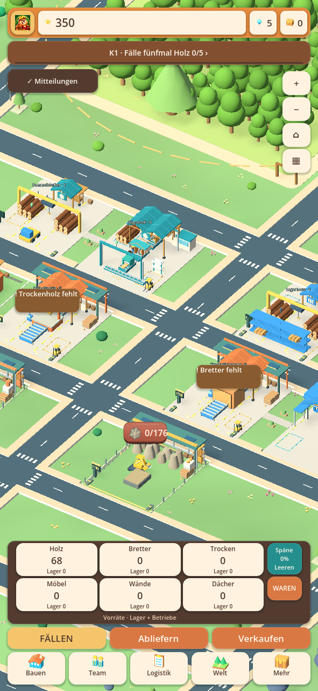
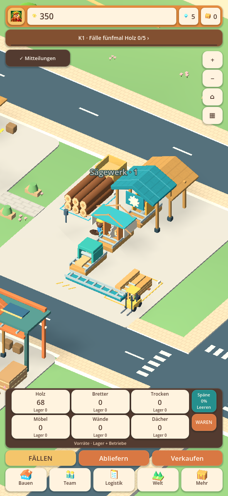
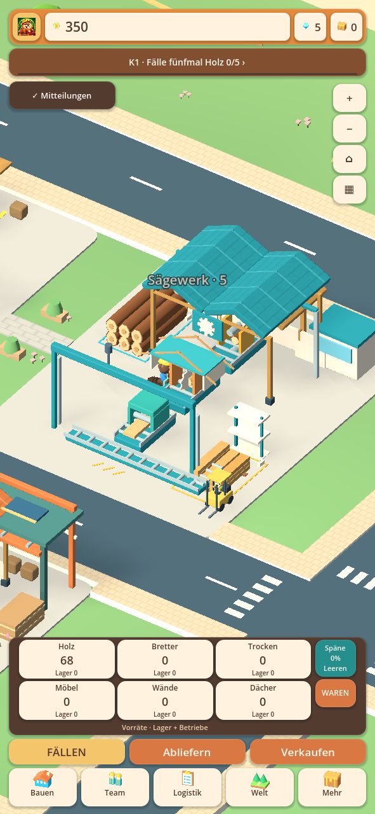
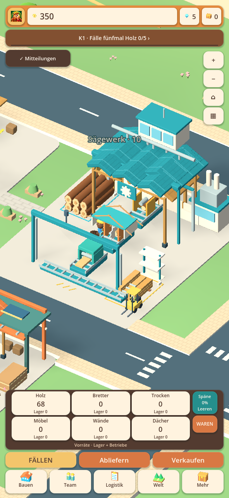
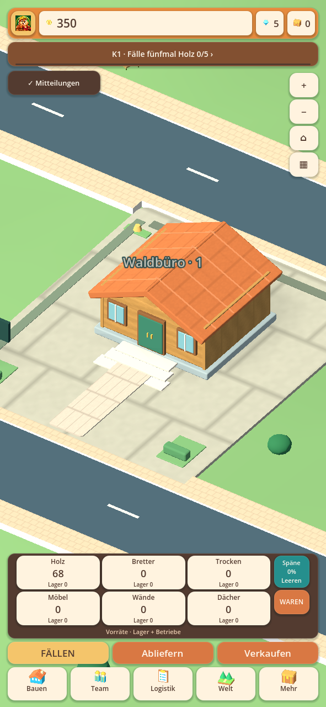
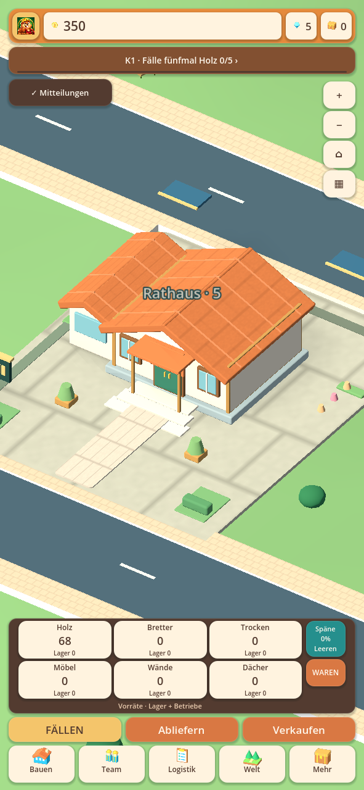
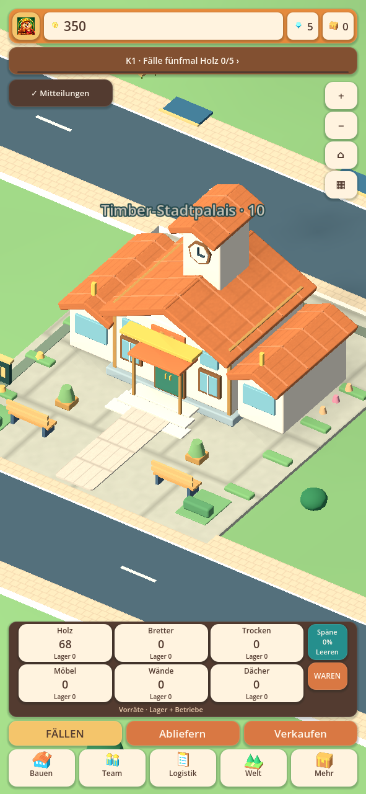
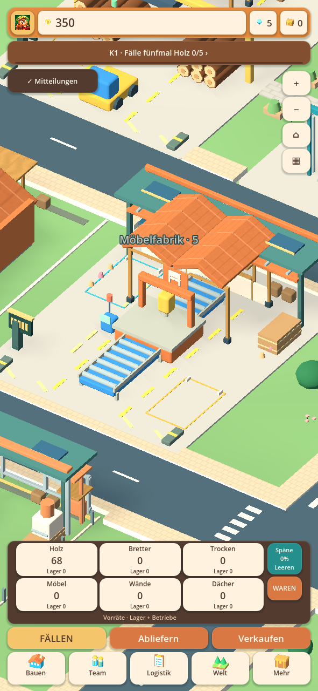
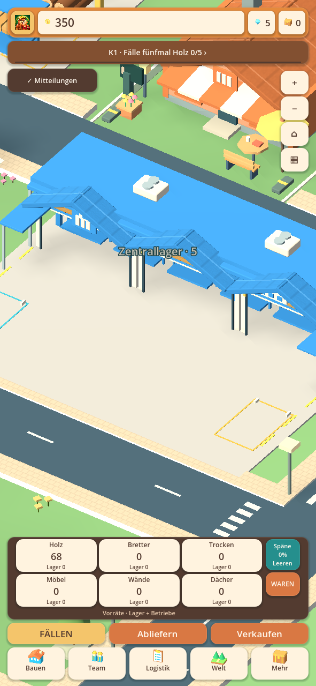

# Einheitlicher Weltstil · 0.28.16-alpha.1

Die Gestaltungsrichtung aus der Gebäudetafel ist jetzt in die bestehende
Hauptwelt übertragen. Die Modelle entstehen aus gemeinsam verwendeten
3D-Bauteilen und Materialien; sie ersetzen keine Produktion durch eine
separate Demo oder ein Bild. Bestehende Spielstände behalten ihre Grundstücke,
Gebäudestufen, Waren, Transportausbauten und laufenden Lieferungen.

## Tatsächlich umgesetzt

| Bereich | Änderung im vorhandenen Spiel |
|---|---|
| Gemeinsame Materialien | Eine zentrale, ausdrücklich benannte Palette für Holz, Cremeputz, Petrol, Logistikblau, Terrakotta, Metall, Asphalt und Wege |
| Sägewerk | Offene Holzrahmenhallen mit ein, zwei oder drei Dachbuchten, Giebeln, Tragwerk, Sockeln und geometrischem Sägezeichen; alle vorhandenen Stufen bleiben integriert |
| Weitere Holzwerke | Passende Hallen und Berufszeichen für Möbelwerk, Trocknung, Fertighauswerk, Tischlerei, Papier und Pellets; Maschinen und Förderwege bleiben sichtbar |
| Lager | Blaue beziehungsweise goldene Verladefassaden, Giebelvordächer, cremefarbene Pfeiler und erkennbare Ladeöffnungen im Zentrallager und Abhol-Express |
| Rathaus | Zehn neu aufgebaute Architekturzustände: Holzhütte, Vorbau, Putzfassade, Seitenflügel, Garten, Obergeschoss, Uhrturm und repräsentativer Eingang |
| Übrige Stadtgebäude | Bestehende Architekturformen und zehn Stufen erhalten die gemeinsamen Materialien; ihre Baukörper wurden nicht alle neu entworfen |
| Arbeiterhütte, Markt, Forschung, Garage | Familienfarben und geometrische Firmenschilder über dem Eingang statt einer Mischung beliebiger Farben |
| Steinbruch und Steinwerk | Abgestimmte Werkstoffe und abgeschrägte größere Maschinenteile; Fels, Bagger, Fördertechnik und Ausbaustufen bleiben funktionsfähig |
| Fahrzeuge | Wiederverwendbare abgeschrägte Karosserien für Liefer-LKW, Sprinter, Busse, Servicefahrzeuge, Forstmaschinen, Bagger und Muldenkipper |
| Biber | Berufsfarben, Overallbesätze und ein eigenes Helmzeichen; zehn Körper-/Gesichtsvarianten und der vorhandene Animationsaufbau bleiben bestehen |
| Welt | Ruhigeres Gras, abgestimmte Hofflächen, Sandwege und Asphalt. Die vorhandenen verbundenen Straßenflächen werden nicht durch neue Bodenplatten verdeckt |
| Menüs | Abgestimmte warme Farben, zurückhaltendere Glanzkanten/Schatten und gemeinsame Überschriftenschrift; die bisherige Touch- und Scrollbedienung bleibt erhalten |
| Start | Das bereits eingeführte eigene Vollbild-Bibermotiv bleibt erhalten und zeigt die aktuelle Version |

Die neue Hallengestaltung ist ein Baukörper, keine zusätzliche gekaufte
Produktionslinie. Nur tatsächlich erworbene Linien und eingesetzte Biber
arbeiten. Neue Lagerfassaden erhöhen ebenfalls keine LKW-Kapazität gratis.
Die Kapazitätsverbesserungen und bezahlten Transportausbauten aus 0.28.15 bleiben
unverändert wirksam. Dieser Entwurf fügt keine neuen Industriezweige hinzu.

## Bilder aus der wirklichen Hauptszene

Die Bilder zeigen generierte Testfirmen, keine privaten Handyspielstände.
Die Gebäude wurden innerhalb der bestehenden Hauptwelt gerendert.

| Sägewerk 1 | Sägewerk 5 | Sägewerk 10 |
|---|---|---|
|  |  |  |

| Rathaus 1 | Rathaus 5 | Rathaus 10 |
|---|---|---|
|  |  |  |

## Technische Integration

`art/TycoonStyle.gd` enthält die geteilte Palette. Nur ausdrücklich bekannte
alte Farben werden zusammengeführt; Warnrot, Statusgrün und die verschiedenen
Waldregionen werden nicht pauschal nach Farbton ersetzt. Die bisherigen
Rustikal-/Modern-Varianten bleiben erhalten, einschließlich des Rathauses.

`Buildings/TycoonArchitecture.gd` ergänzt statische Holzwerk- und Lagerfassaden
und baut die neue Rathausfamilie auf. Bestehende Knoten für Processing,
InputStock, OutputStock, YardHandling und Connections bleiben erhalten.
Neue Stützen und Wände liegen innerhalb der bisherigen Grundstücke; die
äußeren Staplerwege und die zentrale vordere Fahrzeugzufahrt bleiben offen.
Straßengraph, Kollisions-/Platzierungsflächen und Inventare wurden nicht versetzt.

Statische Architektur wird nach Material zusammengefasst. Dabei wird nun auch
das Material bereits zusammengefasster Teilflächen erhalten. Das verhindert
graue, unbemalte Dächer nach erneutem Zusammenfassen. Größere Fahrzeugkörper
verwenden geteilte abgeschrägte Meshes und weiterhin die vorhandenen
Materialbatches. Sehr kleine Stangen und Markierungen behalten günstige Geometrie.

Es gibt keine zusätzlichen dynamischen Lichter, Bildschirm-AO oder neue
hochaufgelöste Hintergrundvideos. Die bestehende Sichtbarkeitsoptimierung,
Bewegungsreduzierung und adaptive Darstellung bleiben aktiv. Das ist eine
Architekturentscheidung, kein Nachweis eines bestimmten FPS- oder Wärmeverhaltens
auf einem echten Android-Gerät.

## Prüfung und tatsächliche Grenzen

[Quellprüfungen](alpha1-style/automated-checks.json) ·
[Prüfung der tatsächlichen APK-Dateien](alpha1-style/packaged-checks.json).
Die Prüfungen umfassen Architekturgrenzen, Materialien nach mehrfachem Batching,
zehn Rathauszustände, tatsächliche Hauptweltintegration, Biber/Fahrer,
Maschinenanimationen, Touch-Menüs und die unveränderte Wirtschaft.

Die frühere vollständige Masterliste mit zusätzlichen Fabriken und sämtlichen
gewünschten Einzelanimationen ist dadurch nicht vollständig umgesetzt. Dieser
Stand modernisiert den vorhandenen Bestand und ersetzt die Rathausfamilie;
die oben als erhalten bezeichneten Stadtbaukörper sind weiterhin ihre bisherigen
Modelle. Ein echter Android-/Hitzetest und ein privater Handyspielstand liegen
nicht vor. Android-Code 3011, gleiches Paket und bisheriges Testzertifikat.
**Als Update installieren; nicht deinstallieren und keine App-Daten löschen.**
