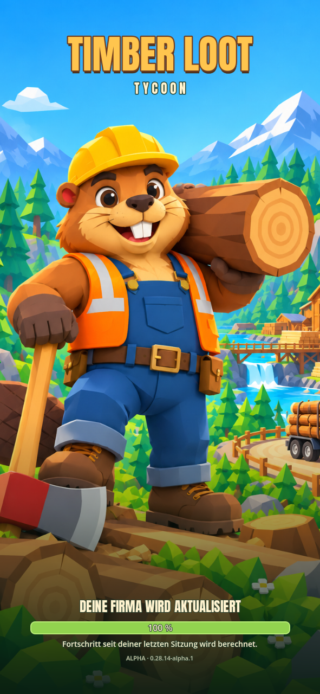
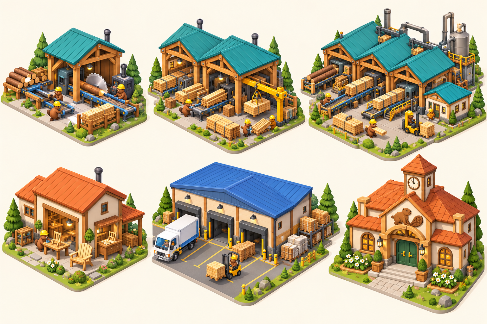

# Timber Loot · Gestaltung von Spielstart bis Rathaus 10

## Tatsächlicher Stand dieses Updates

In der Hauptanwendung umgesetzt: bildschirmfüllendes eigenes Biber-Waldmotiv,
scharfer eigener Godot-Schriftzug, unten liegende Ladeanzeige, derselbe Hintergrund
für die Offline-Nachrechnung, direktes Öffnen der Welt nach abgeschlossenem Laden.
Das separate 3D-Startdiorama und die zeitgesteuerte Introfolge werden nicht mehr
instanziiert. Eine bewusste Rückkehr aus dem Spielmenü hält den Startbildschirm
mit „Weiterspielen“ an. Fehler und beschädigte Speicherdateien bleiben bedienbar.

Die folgende Gebäudetafel und die Stufenbeschreibung sind **Entwürfe für kommende
3D-Arbeit**, keine bereits exportierten Modelle oder fertig integrierten
Gebäudestufen. Der komplette Weltumbau und die zuletzt besprochene Verbesserung
der automatischen Produktionsversorgung sind mit diesem Grafikupdate nicht
abgeschlossen. Wirtschaft, Baukosten und Warenbestände wurden nicht geändert.

## Gemeinsame Formsprache

Große klare Silhouetten, abgeschrägte Holzbalken, kräftige Dachfarben, warme
helle Wände und dunkle Maschinen bilden die gemeinsame Richtung. Arbeit ist von
außen erkennbar: offene Hallenseiten zeigen Maschinen und Waren. Die Gestaltung
orientiert sich an lesbaren Mobile-Tycoons, verwendet jedoch eigene Motive und
Biber statt Menschen. Keine fremden Logos, Figuren oder Screenshots als Assets.

| Funktion | Farbe und Material | Erkennungsmerkmal ohne Farbe |
|---|---|---|
| Holzproduktion | Petrol `#278f98`, honigfarbenes Holz | Sägezahn-Schild, offene Fördertechnik |
| Möbel | Terrakotta `#d97843`, cremefarbener Putz | Stuhl-Schild, Fenster zur Werkbank |
| Logistik | Blau `#398ed1`, helle Metallflächen | Nummerierte Tore, Palettenzeichen |
| Rathaus und Wohnen | Ziegeldach, cremefarbene Wände | Biberemblem, Eingang, später Uhrturm |
| Baustelle | Warmes Gelb, dunkler Asphalt | Schraffur, Werkzeugzeichen, Bauphase |
| Landschaft | Drei Grüntöne, Sandwege, grauer Fels | Deutliche Wege und zusammenhängende Waldflächen |

Warnrot zeigt Fehler, Grün Verfügbarkeit, Gelb eine ausstehende Lieferung.
Jeder Status erhält zusätzlich ein Symbol und eine kurze Erklärung. Der
allgemeine Grafikstil bleibt freundlich; funktionale Warnfarben werden sparsam
verwendet. Industriefarbe und Produktfarbe dürfen einander nicht widersprechen.

## Gebäudefamilien und Modellieraufträge

Obere Reihe von links: frühes, mittleres, spätes Sägewerk. Untere Reihe:
Möbelwerk, Zentrallager, Rathaus. Dies ist eine Illustrationsvorlage. Details,
Abmessungen und Fahrzeugwege müssen beim Bau der echten Modelle geprüft werden.

- **Sägewerk:** Sichtbare Einfahrt für Stämme, Entrinder, geschützte Säge,
  Hobel und eigener Bretterausgang. Neue Stufen ergänzen Hallenfelder und echte
  gekaufte Linien; weitere Dachfelder dürfen keine Gratisproduktion vortäuschen.
- **Möbelwerk:** Werkbänke und Gestelle zuerst, danach Montageplätze,
  Verpackung und separate Ausgangspaletten. Sichtbare Möbel passen zum Produkt.
- **Zentrallager:** Eindeutige Eingangs- und Ausgangstore, Staplergasse und
  Wartestellplätze. Hofgröße folgt der vorhandenen Flotte und ihren Wendekreisen.
  Lagerbestand wird durch belegte Stellplätze repräsentiert, ohne pro Einheit
  ein eigenes 3D-Objekt zu erzeugen.
- **Rathaus:** Ein bodenständiges Biberhaus wächst zu einem erkennbaren
  Stadtmittelpunkt. Uhrturm, Seitenflügel und Vorplatz ersetzen bloße Skalierung.
- **Arbeiterhütte:** Kleine Holzunterkunft, Werkzeugregal, später überdachter
  Sprinter-Stellplatz. Arbeiter müssen den Eingang und den Abfahrtsplatz erreichen.
- **Trocknung und Baustoffe:** Die Silhouette zeigt die Funktion: Luftlamellen
  für Trockenkammern, Fels-/Brecheranlage für Stein, Silos für Beton. Kein
  identisches Hallenmodell mit nur anderer Farbe.

## Rathaus 1–10: gestalterische Entwicklung

Die Einteilung ist ein Designziel; Freischaltungen und Dauer benötigen eine
separate Balanceprüfung. Bestehende Freischaltungen werden hierdurch nicht verändert.

| Stufe | Rathaus | Umgebung und nächster Gestaltungsbaustein |
|---|---|---|
| 1 | Kleines Holzhaus, einfaches Biberzeichen | Waldlichtung, ein klarer Arbeitsweg, kleine Werkstatt |
| 2 | Wetterschutz am Eingang, Materialregal | Ordentliche Holzablage und beschilderte Zufahrt |
| 3 | Verputztes Erdgeschoss, größerer Arbeitsraum | Trocknung und Möbelwerk erhalten eigene Silhouetten |
| 4 | Seitlicher Büroanbau, erste Pflasterfläche | Wohnhöfe mit verbundenen Gehwegen und Gärten |
| 5 | Massiver Sockel, Materialmuster am Bauhof | Steinbruch, Brecher und erreichbare Ladeplätze |
| 6 | Zweiter Gebäudeflügel, überdachter Eingang | Großer Logistikhof mit getrennten Rampen |
| 7 | Werkstatt-/Planungsanbau, gestalteter Garten | Mehrere sichtbare Produktionslinien und Arbeitsplätze |
| 8 | Kleiner Uhrturm, deutlichere Dachgliederung | Regionales Expresslager und eigener Quartiersplatz |
| 9 | Vollständiger Seitenflügel, Besprechungsraum | Materialhöfe und sichtbare Bauphasen der Großprojekte |
| 10 | Großer Uhrturm, Biberrelief und Marktplatz | Zusammenhängendes Stadtzentrum mit Feier- und Alltagsnutzung |

Jede Erweiterung bleibt innerhalb einer vorgeplanten Ausbaubaufläche. Fenster,
Dachsegmente und Anbauten haben eine Funktion; keine zehn Farbvarianten als
Ersatz für zehn Architekturstufen. Das Rathaus bleibt im Maßstab zu Bibern,
Türen, Fahrzeugen und Nachbargebäuden.

## Benutzeroberfläche und Bewegung

- Start: Motiv und Markenname oben; tatsächlicher Ladevorgang unten. Keine
  zusätzliche Begrüßungskarte vor jedem Laden und kein künstlicher Countdown.
- Betrieb: Rohstoff → Verarbeitung → Produkt in einer kurzen Zeile; fehlende
  Lieferung und volle Ausgabe sind unterscheidbar. Detailbestände erst bei Auswahl.
- Bauen: Große lesbare Baukarten mit Silhouette, Grundfläche, Kosten und
  Materialien; Materialicons bleiben in Lager, LKW und Baustelle gleich.
- Upgrade: Vorher-/Nachheransicht mit tatsächlich ergänzten Modulen. Kein
  hochskalierter Hintergrund, der zusätzliche Produktionslinien verspricht.
- Welt: Arbeit und Ladeaktionen bewegen sich nur bei tatsächlichem Vorgang.
  Rauch und Warnlicht bleiben dosiert; es gibt keine dauernden Bildschirmfunken.
- Zugänglichkeit: Texte, Symbole und Status bleiben ohne Animation verständlich.
  Bewegungsreduzierung muss keine Information verstecken.

## Umsetzungsetappen nach diesem Startupdate

1. Automatische Holz-/Bretter-/Möbelversorgung mit nachvollziehbarem Durchsatz
   und ohne manuelle Notlieferungen prüfen und verbessern.
2. Sägewerkfamilie auf diese Bauformen abstimmen; Material- und Fahrwege erhalten.
3. Möbelwerk, Trocknung und Logistikhof als zusammenhängende Baugruppe modellieren.
4. Rathausformen und Stadtviertel stufenweise in echte Upgrades integrieren.
5. Je Baugruppe reale Hauptwelt, mobile Lesbarkeit, Straßen, Inventar und
   bestehende Spielstände prüfen. Das Konzeptbild ersetzt diese Integration nicht.
