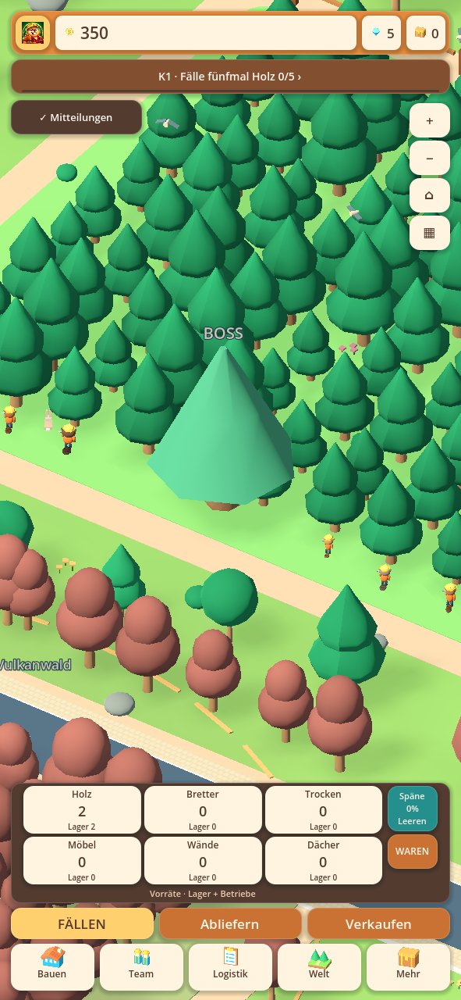
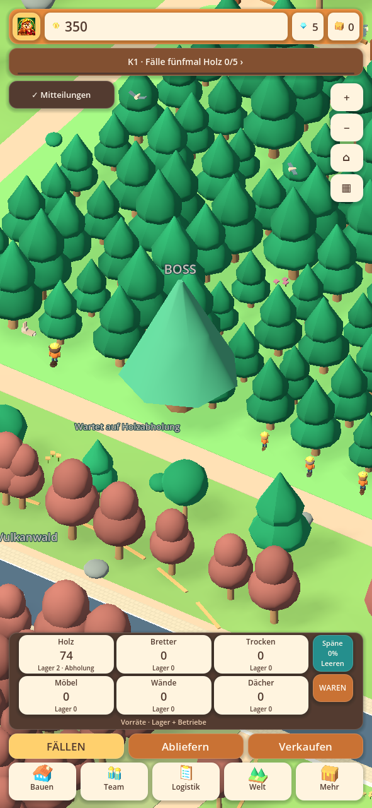

# Waldzugang und Holzfäller · 0.28.13-alpha.1

Der gemeldete Screenshot zeigt einen tatsächlichen Darstellungsfehler: Die
Holzfäller hatten ihre Arbeitsplätze vor dem Waldzaun und trugen dort ihre
bereits verbuchten Erntemengen hin und her. Sie gingen nicht an die Baumreihe.
Die Absperrung selbst besaß keinen Kollisionskörper und blockierte nicht die
Wirtschaftsberechnung. Im Screenshot ist außerdem der Zustand „Abholung“ auf
der Holzkarte erkennbar; aus dem einzelnen Bild lässt sich dessen Dauer nicht
feststellen. Ein privater Handyspielstand lag für diese Prüfung nicht vor.

## Korrektur in der Hauptwelt

- Die ganze Arbeitsfront ist offen. Der Zaun markiert die hintere Waldgrenze;
  zwischen Baumreihe und Sammelweg steht keine Querabsperrung mehr.
- Holzfäller erhalten Arbeitsplätze vor tatsächlich stehenden, erreichbaren
  Bäumen im Wald. Breite Kronen und der große Bossstamm werden berücksichtigt.
- Die Tragewege laufen über Waldgassen und die offene Sammelfläche zum
  Holzablagepunkt. Hin- und Rückweg folgen derselben geprüften Route.
- Ein abgeernteter Arbeitsplatz wird neu gewählt. Der Biber geht mit leeren
  Händen zum nächsten Baum, statt zum neuen Ziel zu springen.
- Kann kein gültiger Arbeitsplatz gewählt werden, gibt es keine erfundene
  Fällbewegung. Wachstum und Nachwuchs bleiben im vorhandenen Forstsystem.
- Wartet die Ernte auf freie Abholung oder ist das Holzlager voll, erscheint
  ein kleiner konkreter Wartehinweis an der Waldfront.

Die Wirtschaftsberechnung bleibt Eigentümer der Holzbestände und Ernte. Die
Animation zeigt akzeptierte Arbeit beziehungsweise eine echte Ladebuchung;
sie schreibt selbst keine Ware. Das vorhandene Arbeitstempo der Darstellung ist
weiter eine begrenzte Repräsentation der gesamten Crew und kein neues Inventar
je sichtbarem Biber. Eine volle Sammelstation muss real abgeholt werden, ein
volles Lager muss Platz bekommen. Es wird weder unbegrenztes Holz erzeugt noch
eine kapazitätsbedingte Pause durch Daueranimation verdeckt.

## Prüfung

[Quellprüfungen](alpha1-forest-access/automated-checks.json) ·
[Prüfung der tatsächlichen APK-Dateien](alpha1-forest-access/packaged-checks.json).

Die neue Prüfung stellt einen frühen Betrieb mit sechs Helfern, 1.050 Holz im
Lager, 1.183 Brettern und einem vollen Abholvorrat von 80 Holz nach. Ohne einen
manuellen Fäll-/Ablieferaufruf muss ein echter LKW Holz abholen und die automatische
Ernte wieder stattfinden. Ein getrennt geprüfter voller Lagerbestand darf
keinen weiteren Ertrag erfinden. Arbeitswege umgehen bestehende Grundstücke
und Maschinenstände. Grafikprüfungen kontrollieren den fehlenden Frontzaun,
Axtbewegungen im Wald, Tragewege, leere Rückfahrt, kontinuierlichen Baumwechsel
und die unveränderte Materialbilanz.

Die Bilder zeigen die reale Hauptwelt mit einer generierten Testfirma:

Bestehende Gebäude, Fortschritte und gespeicherte Waren werden nicht umgebucht.
Android-Code 3008, gleiche Paketkennung und bisheriges Testzertifikat.
**Als Update installieren; nicht deinstallieren und keine App-Daten löschen.**
Kein physischer Android-/Hitzetest und keine Prüfung des privaten Handyspielstands.
Die komplette frühere Masterliste bleibt über diesen Waldzugangsfix hinaus offen.
