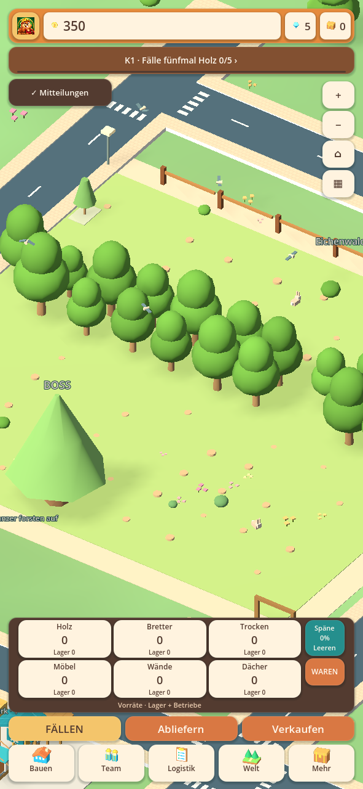
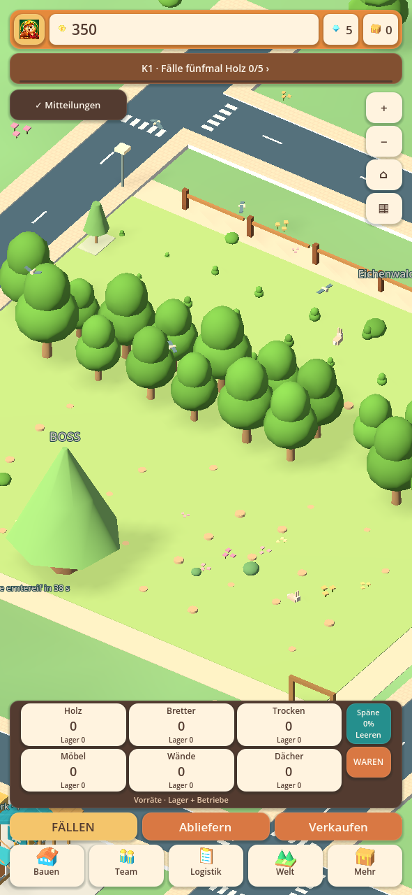
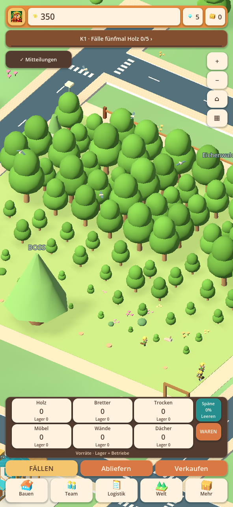

# Wiederaufforstung · 0.28.17-alpha.1

Die Nachwuchsphase war mit 90 Sekunden lang, während das Pflanzteam pro Baum
Hinweg, vier Sekunden Arbeit und Rückweg leisten musste. Die Automatik blieb
auch bei kahlem Wald auf höchstens die Hälfte der Helfer begrenzt. Schnelle
Holzfäller konnten dadurch deutlich mehr Fläche abernten als nachgepflanzt wurde.
Zusätzlich ließ sich an einzelnen Stellen Holz ernten, obwohl ihr Pflanzweg durch
Bauten oder reservierte Flächen versperrt war. Diese Stümpfe konnten nicht
regulär aufgeforstet werden.

## Änderung im bestehenden Spiel

- Jungbäume sind **45 Sekunden nach dem tatsächlichen Pflanzen** erntereif.
  Anfahrt und Pflanzarbeit bleiben reale Voraussetzungen.
- Die automatische Zuteilung wächst bei abnehmendem Baumbestand schrittweise
  von 50 auf höchstens 80 Prozent der vorhandenen Helfer. Bei Erholung gibt sie
  Helfer wieder zum Fällen frei. Es entstehen keine zusätzlichen Arbeiter.
- Neue Pflanzmissionen laufen auf denselben geprüften Wegen mit 8 statt
  6 Welteinheiten pro Sekunde; vier Sekunden Pflanzarbeit und der Rückweg
  bleiben erhalten. Bestehende Missionen behalten ihre gespeicherten Fahrzeiten.
- Neue Fällvorgänge berücksichtigen denselben erreichbaren Waldgang wie die
  Pflanzer. Kein neues Fällen hinter einer versperrten Pflanzzufahrt.
- Alte 90-Sekunden-Jungbäume erhalten beim nächsten Simulationstakt die kürzere
  Frist unter Anrechnung ihres bisherigen Alters. Beispiel: nach bereits
  30 Sekunden bleiben 15 Sekunden, kein neuer kompletter Timer.
- Auch im völlig abgeernteten Wald bleiben die tatsächlich beauftragten Pflanzer
  sichtbar. Ihre Anzeige hängt nicht mehr von vorhandenen Holzfällerfiguren ab.
- Teammenü und Wald zeigen tatsächliche Jungbäume, erntereife Bäume und den
  nächsten Erntezeitpunkt. Eine ausgeschaltete Pflanzzuweisung wird erklärt.
- Explizite manuelle Zuweisungen, auch null Pflanzer, bleiben erhalten.

Die Warenbestände werden dabei nicht aufgefüllt. Erst erneutes tatsächliches
Fällen eines ausgewachsenen Baums erzeugt Holz. Die Grafik bleibt lesend und
verändert keine Wachstumsfristen. Bestehende unzugängliche Pflanzstellen brauchen
weiterhin einen freien Zugang; das Update teleportiert keine Arbeiter durch Bauten.

## Messung und Prüfung

Generierter Eichenwald mit kontinuierlicher Holznachfrage, 900 simulierte
Sekunden, Werkzeug 11. Ausschließlich echte endliche Waldzellen und Pflanzmissionen;
der Versuch isoliert den Waldkreislauf von begrenzten Lagern und LKW-Wartezeiten.
Mit 8 Helfern bleiben nach der Einlaufphase mindestens 33 erreichbare erntereife
Bäume, mit 31 Helfern mindestens 18. Beide Läufe haben keine Sekunde ohne Ernte.
Das ist ein Belastungsversuch für diese Konfiguration, kein allgemeines
Langzeit-Balancing für jeden Forschungs-/Booststand.

Ein vollständig abgeernteter erreichbarer Eichenbestand bringt mit 31 Helfern
innerhalb von 70 Sekunden erste erntereife Bäume zurück; nach 180 Sekunden sind
mindestens 70 Bäume wieder erntereif. Kein Holz wird durch diese Regeneration
ins Warenlager gebucht. Separat geprüft sind ausgeschaltete Pflanzer, alte
Wachstumsfristen, identische Fortsetzung nach Speichern/Laden und reservierte Wege.

[Quellprüfbericht](alpha1-regrowth/automated-checks.json) ·
[Prüfung der APK-Dateien](alpha1-regrowth/packaged-checks.json).
Die Bilder zeigen die wirkliche Hauptszene mit einer generierten Testfirma.

Vorhandener Grafikstand 0.28.16 bleibt erhalten. Keine neue Fabrik und kein
Abschluss der früheren vollständigen Masterliste. Kein privater Handyspielstand,
kein physischer Android-Gerätelauf und keine Temperaturmessung.
Android-Code 3012, gleiche Paketkennung und dasselbe Testzertifikat.
**Als Update installieren; nicht deinstallieren und keine App-Daten löschen.**
