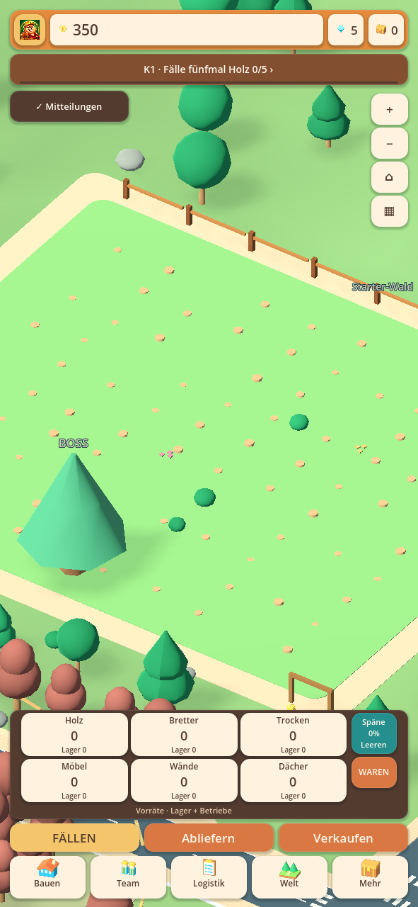
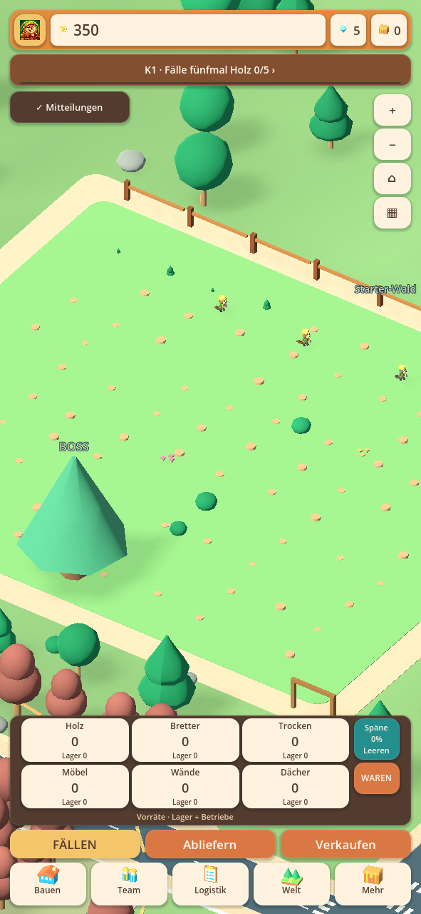
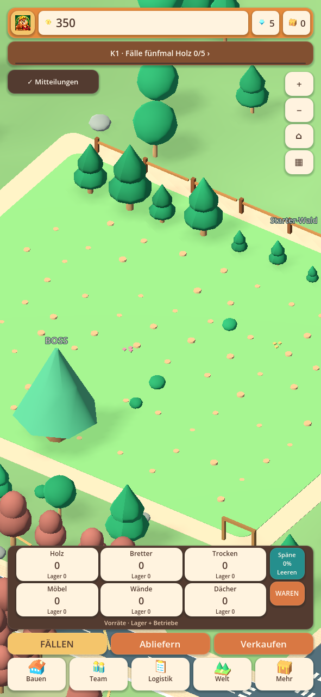

# Starterfeld und Waldwechsel · 0.28.18-alpha.1

Das Starterfeld konnte nach dem Wechsel zum Eichenwald dauerhaft kahl bleiben.
Der bisherige Verteiler füllte freie Pflanzplätze immer zuerst aus dem aktuell
gewählten Wald. Wurde dort weiter gefällt, kamen kleine Pflanzteams nie mehr
zum alten Starterfeld. Die 45-Sekunden-Wachstumsphase aus 0.28.17 konnte nicht
helfen, wenn dort überhaupt kein Biber einen Jungbaum pflanzte.

## Konkrekte Änderung

Freie Pflanzmissionen wechseln jetzt reihum zwischen allen bereits abgeernteten
Wäldern. Ein gespeicherter Verteilerzeiger sorgt dafür, dass auch ein einzelner
Pflanzer nach seinem Rückweg die nächste Waldfläche bedient. Neue Stümpfe im
aktiven Wald verdrängen dadurch das ältere Starterfeld nicht dauerhaft.
Ein Wald ohne offene oder erreichbare Pflanzstellen wird übersprungen.

Alte Spielstände ohne diesen Verteilerzeiger erhalten ihn ergänzend. Bestehende
Pflanzmissionen behalten Anreise, Alter, Pflanzarbeit und Rückweg. Erst nach
Freigabe einer Helferstelle wird eine neue Mission vergeben. Keine Mission wird
abgebrochen oder teleportiert. Manuelle Teamgrößen einschließlich null bleiben
erhalten. Die Zahl der Biber bleibt auf die tatsächlich eingestellten Helfer
begrenzt. Wachstum dauert weiterhin 45 Sekunden nach tatsächlichem Pflanzen.

Das bestehende Teammenü zeigt nun zusätzlich die einzelnen abgeernteten Wälder:
Pflanzer, Jungbäume und offene Pflanzstellen. „STARTER-WALD ANSEHEN“ führt die
Kamera direkt zum Anfangsfeld. Die Auswahl des Produktionswaldes bleibt dabei
bestehen. Es gibt kein neues separates Menü.

## Reproduktion und Prüfung

Generierter Altspielstand mit vollständig abgeerntetem Starter- und Eichenwald,
Werkzeug 11, Auswahl weiterhin Eichenwald und dort kontinuierliche Holznachfrage.
Der Versuch isoliert die Waldverteilung von LKW- und Lagerkapazitäten.

| Helfer | Starter nach 900 s vorher | Starter nach 900 s jetzt | Erste Starterbäume jetzt |
|---|---:|---:|---:|
| 1 | 0 erntereif, kein Pflanzauftrag | 16 erntereif | 65 s |
| 8 | 0 erntereif, kein Pflanzauftrag | 100 erntereif | 63 s |
| 31 | 100 erntereif | 100 erntereif | 58 s |

Das sind Messwerte dieser generierten Konfiguration, keine garantierten Zeiten
für jeden Spielstand. Bereits laufende Altmissionen müssen zunächst zurückkehren.
Ein zusätzlicher Test lädt ausschließlich laufende Aufträge im aktuellen Wald
und bestätigt anschließend neu erntereife Starterbäume. Mit einem Pflanzer werden
auch alle zehn besuchten Waldflächen trotz ständig wechselnder Auswahl bedient.
Manuell ausgeschaltetes Pflanzen und tatsächlich versperrte Zugänge bleiben
korrekte Stopbedingungen; kein Weg durch Gebäude wird erzwungen.

Die Regeneration füllt keine Warenlager und erzeugt keine Ernte-Erfolge.
Erst tatsächliches Fällen eines ausgewachsenen Baums liefert erneut Holz.
Speichern/Laden erhält Verteilungszeiger und Missionszeiten. Die Darstellung
ist lesend und kann weder Pflanzaufträge noch Waren erzeugen.

[Quellprüfbericht](alpha1-starter/automated-checks.json) ·
[Prüfung der APK-Dateien](alpha1-starter/packaged-checks.json).
Bilder aus der tatsächlichen Hauptszene mit generiertem Altprofil, aktivem
Eichenwald und Kamera auf dem Starterfeld:

Kein privater Handyspielstand, kein physischer Android-Gerätelauf und keine
Temperaturmessung. Bestehende Gestaltung und Logistik bleiben erhalten;
die frühere vollständige Masterliste bleibt offen. Android-Code 3013, gleiches
Paket und bisheriges Testzertifikat. **Als Update installieren; nicht vorher
deinstallieren und keine App-Daten löschen.**
