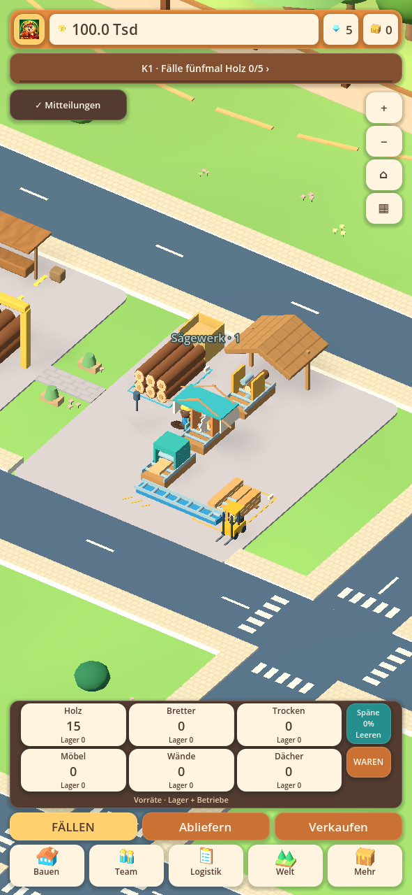
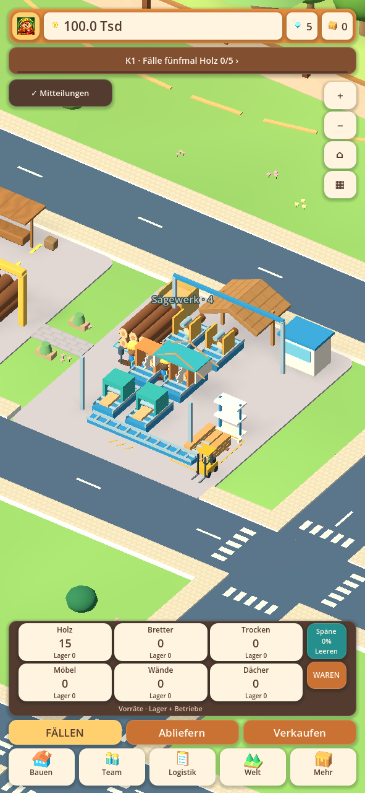
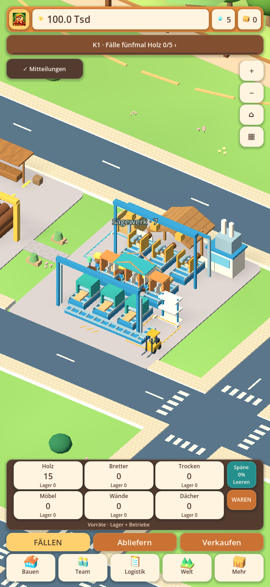
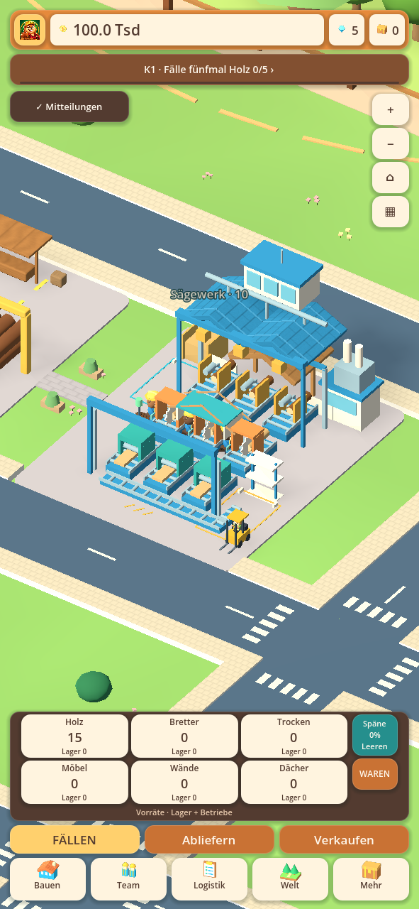
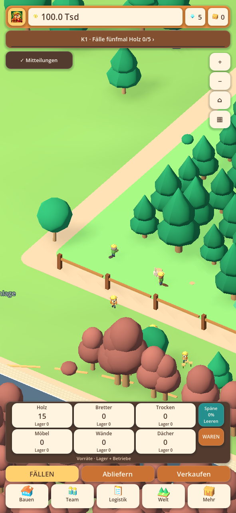

# Tatsächliche Hauptwelt · 0.28.12-alpha.1

Diese Bilder zeigen die laufende Hauptwelt mit einer generierten Testfirma,
keine nachbearbeiteten Konzepte. Für die Bauformen wurde dasselbe vorhandene
Sägewerk jeweils mit seinem abgeschlossenen Level dargestellt.

## Werkstufe 1

## Werkstufe 4

## Werkstufe 7

## Werkstufe 10

## Baumpflanzer

## Alle zehn Bauformen

[1](sawmill-stage-01.png) · [2](sawmill-stage-02.png) · [3](sawmill-stage-03.png) ·
[4](sawmill-stage-04.png) · [5](sawmill-stage-05.png) · [6](sawmill-stage-06.png) ·
[7](sawmill-stage-07.png) · [8](sawmill-stage-08.png) · [9](sawmill-stage-09.png) ·
[10](sawmill-stage-10.png).

Die gezeigte Firma dient der automatisierten Prüfung und ist kein privater
Handyspielstand. Der mobile Screenshotausschnitt ist am Desktop gerendert.
