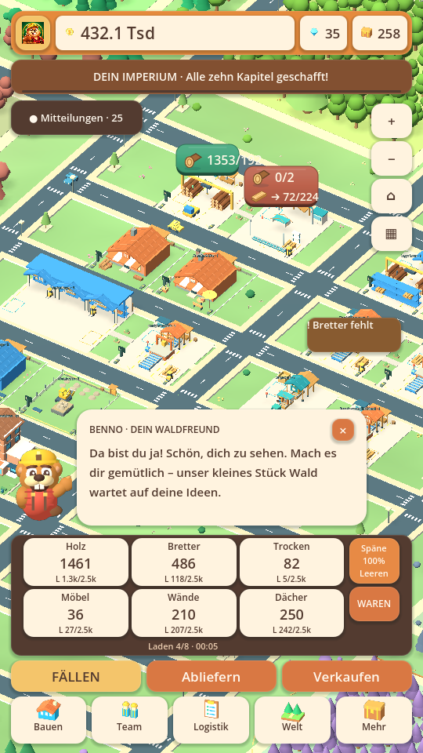

# Rathaus 1–10: tatsächlicher Simulationsdurchlauf

Stand: 28.10.2026 · Kandidat 0.28.29-alpha.1 · Baseline `73cd20bc9e490634fe7c75123bbd45bf44c72967`.

Zwei **frische Spielstände** erreichen Rathaus 10 und alle zehn abgeholten
Kapiteltrophäen. Bennos Einführung wird mit fünf echten Fällaktionen, Abliefern,
Bretterproduktion, Verkauf und einer tatsächlich fertiggebauten zusätzlichen
Arbeiterhütte abgeschlossen. Kein Überspringen der Einführung, kein Vorgreifen
auf Kapitel, keine hinzugefügten Münzen, Materialien, Gebäude oder Zielzähler.

| Rathaus fertig / Kapitel abgeholt | Aktiv, Seed 41 | Ruhiger, Seed 93 |
|---|---|---|
| 1 | 00:08:45 | 00:11:40 |
| 2 | 00:20:05 | 00:21:20 |
| 3 | 00:37:45 | 00:35:40 |
| 4 | 00:56:10 | 00:58:00 |
| 5 | 01:59:55 | 01:55:40 |
| 6 | 03:03:35 | 02:55:40 |
| 7 | 04:08:00 | 04:02:00 |
| 8 | 04:39:50 | 04:36:20 |
| 9 | 06:51:10 | 06:59:40 |
| 10 | 08:55:25 | 09:09:00 |

Zeitformat Stunden:Minuten:Sekunden; gemessen am Wirtschafts-Zeitzähler, keine
vorgegebene Spielzeit für Menschen. Der aktive Bot entscheidet alle fünf, der
ruhigere alle zwanzig Sekunden. Eine Entscheidung kann auch nur Warten bedeuten.
Es sind insgesamt 627 bzw. 583 protokollierte Aktionen, keine dauernde
manuelle Holzversorgung. Ab Unternehmenslevel 5 wird nicht mehr von Hand gefällt.

## Zwei echte Probleme behoben

1. **Eigene Baustoffe wurden nicht für Kapitel 6 gezählt.** Der alte
   `StoneIndustry`-Transport erhöhte den Zähler, Abholungen der neueren zentralen
   Logistik nicht. Die unveränderte Baseline bleibt deshalb auch nach sechs
   simulierten Stunden bei Rathaus 5 / `stone:2`, obwohl 2.500 Bausteine im Lager
   liegen. Nun zählt eine tatsächliche Entladung aus einem Steinwerk in Zentrale
   oder Express. Gestein, Kauf, Weiterleitung zwischen Lagern und Rückfahrten
   zählen nicht erneut. Eine blockierte Entladung zählt erst nach Freigabe.
2. **Rathaus 6 braucht Kies, ein neues Steinwerk blieb fest auf Bausteinen.**
   Neue Steinwerke wählen jetzt vor dem nächsten Arbeitsgang anhand offener
   Baurechnungen und eines Grundvorrats von 20 je Ware zwischen Bausteinen und
   Kies. Bereits vorhandene Ware, Ladungen und laufende Produktionslose werden
   berücksichtigt. Ein begonnenes Los endet zuerst. Material wird weiterhin
   wirklich verbraucht und per LKW transportiert.

Ältere Steinwerke behalten ihre bisherige manuelle Wahl. Im Steinwerk kann man
„Bedarfsautomatik“ einschalten; ein konkretes Rezept schaltet wieder auf manuell.
Die Einstellung wird gespeichert und validiert. Historische Lieferungen werden
nicht erfunden oder nachträglich pauschal vergeben; bestehende Waren bleiben
unangetastet. Bei vollen alten Fächern muss erst Platz für eine neue Anlieferung
entstehen, bevor der korrigierte Lieferzähler weitersteigt.

## Was der simulierte Spieler tatsächlich tut

Alle Käufe, Ausbauten, Verkäufe und Freischaltungen verwenden dieselben Game-APIs
wie die Oberfläche. Bauflächen werden über die bestehende Platzprüfung gesucht;
beim Straßenbau wird eine gültige freie Erweiterung am Netz gewählt. Bauten
warten auf Waren, Straßen, Transporte und Bauteams. Es laufen höchstens zwei
nebenbei bestellte Ausbauprojekte; Pflichtziele werden zuerst behandelt.

Der Bot kauft nach Bedarf Helfer, Zentrale, Garage, zusätzliche LKW, Ladeausbau,
Produktionsstufen und den vorhandenen Mietmanager. Er verkauft zunächst echte
Überschüsse, um Ausgaben zu finanzieren; bei ausreichendem Einkommen werden
Zwischenprodukte behalten. Möbelverkäufe erfüllen die entsprechenden Ziele.
Er erschließt bezahlte Steinadern, kauft fehlende Kleinteile und erweitert
Waldregionen, Wohnraum und Stadtviertel. Keine Boss-/Prestige-/Loot-Schleifen,
keine wiederholt erfundenen Belohnungen. Kosten, Rezepte, Rathausschwellen und
Münzerträge wurden nicht für einen grünen Test heruntergesetzt.

## Speichern, Offline und Grenzen

- Pro Durchlauf zehn JSON-Wiederherstellungen und echte Datei-Speicherungen bei
  Rathaus 3, 6 und 9; danach unveränderte Zustandsinhalte geprüft.
- Der verdiente Rathaus-6-Zwischenstand läuft weitere 30 Minuten im tatsächlichen
  `CompanyReplay`-Hintergrundworker und im normalen Wirtschaftstakt. Die kompletten
  Zustände stimmen nach Normalisierung des Speicherzeitstempels überein; dieses
  Vergleichsergebnis wird dem Durchlauf nicht als zusätzlicher Ertrag zugeschlagen.
- Jede simulierte Minute werden endliche/nichtnegative Bestände aller Lager und
  Puffer sowie die Kapazität des Hauptlagers geprüft. Keine Verletzung gefunden.
- Der tatsächlich verdiente Endstand wird in der Hauptwelt geladen. Kapitelende
  und die Steinwerk-Schalter werden grafisch und mit Touch-Eingaben geprüft.
- Ein älterer Oberflächentest erwartete einen Holz-Kurzauftrag nach exakt 130 s.
  Er wartet nun begrenzt auf tatsächlichen Ertrag; derselbe Starterhelfer pflanzt
  auch nach. Die Auftragsmenge und Auszahlung bleiben unverändert.

Das ist eine deterministische Wirtschaftssimulation mit zwei Spielerstrategien,
kein menschlicher Langzeittest oder Android-FPS-Nachweis. Physische NPC-Kollisionen,
Lesbarkeit auf allen Geräten, Spaß, Wartegefühl und alternative Spielweisen
brauchen weiterhin Geräte- und Spieltests. Andere Bugs sind dadurch nicht
pauschal ausgeschlossen.

## Wiederholen

```sh
bash scripts/test.sh JourneyPlaythrough JourneyLogistics
TIMBER_JOURNEY_SEED=93 TIMBER_JOURNEY_INTERVAL=20 bash scripts/test.sh JourneyPlaythrough
bash scripts/test_visual.sh VisualJourneyProgress VisualJourney
```

Ein Testprofil wird von `test.sh` isoliert angelegt. Optional schreibt
`TIMBER_JOURNEY_REPORT` einen vollständigen Bericht und `TIMBER_JOURNEY_SAVE`
einen Simulationsstand. `TIMBER_JOURNEY_SECONDS` setzt lediglich ein Zeitlimit;
erreichte Ziele werden dabei niemals aufgefüllt.

[Aktiv: kompletter Aktionsverlauf](active.json) · [Ruhiger Verlauf](calm.json) ·
[Baseline mit derselben Spielerregel](before.json).
`Tests/Fixtures/journey-rh10-earned.json` ist ein erzeugter Teststand und wird
nicht in die Android-App exportiert. Das Bildschirmbild zeigt diesen Zustand
in der echten Hauptwelt mit Linux-Softwarerendering.



## Android-Testpakete

[APK-Updates und Installationshinweise](../../releases/RATHAUS-0.28.29-alpha.1.md).
Beide ARM64-Varianten wurden aus Quell-Commit
`d4406588c5a72acba86bb536d45f729f8233cd87` gebaut und mit dem bisherigen
Testzertifikat geprüft. Ein weiterer vollständiger Durchlauf samt Einführung,
Datei-Speicherungen und echtem Offline-Worker-Vergleich lief je Variante mit den
unveränderten, aus der signierten APK entpackten Spielressourcen durch.
Zusätzlich je 32 Transport-/Automatikprüfungen, 11 Musik- und 22 Speicherprüfungen
sowie 13 grafische Endspiel-/Touch-Prüfungen; null fehlgeschlagene Prüfungen.

Die zwei Pakete haben 1.013 Ressourcen gemeinsam; nur Renderereinstellung und
zugehöriger Ressourcenindex unterscheiden sich. Das sind Desktop-Prüfungen
mit Godot 4.6.3 und Software-GPU, keine Installation auf Android-Hardware.
[Paketergebnisse](packaged-checks.json) · [Ressourcenvergleich](renderer-parity.json).
